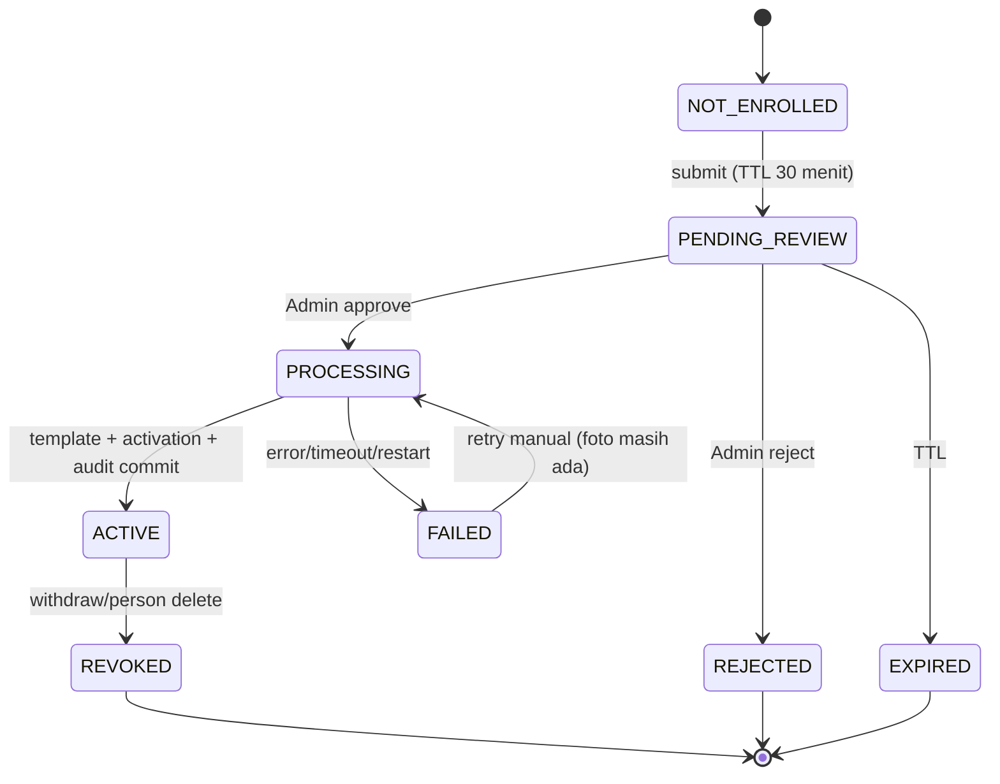
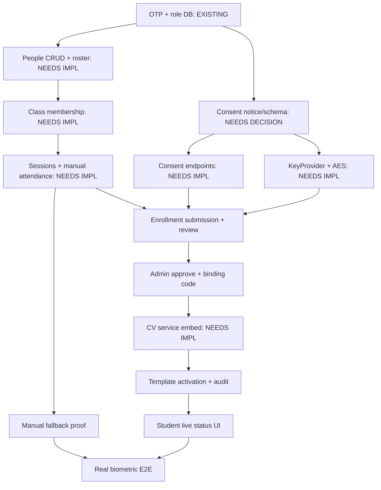

# FL-ENR00R — Face Enrollment V1: Decision & Security Review

**Tanggal:** 24 Oktober 2026. **Status:** REVIEW READ-ONLY — BUKAN PERSETUJUAN.
**Baseline:** `feat/fl-otp01-email-auth`, HEAD `87bac5e96602e9ff5568069d1c6b1bd1d96913b7`.
**Dokumen yang direview:** [`docs/FACE_ENROLLMENT_V1.md`](FACE_ENROLLMENT_V1.md).
**Sifat:** decision package untuk Technical Advisor dan Product Owner. Tidak ada source, schema, UI, database, akun, SMTP/DNS, atau backup yang diubah. Tidak ada implementasi, migration, inference, kamera, atau capture wajah nyata.

> **Pembaruan otoritas FL-ENR01B (26 Oktober 2026):** Product Owner menyetujui arah P01–P12 dan backend **sintetis/disposable saja**. OPEN/RECOMMENDED/BLOCKED di bawah adalah hasil review historis24Oktober. Pending resmi72jam menggantikan7hari/≤30menit. Residual binding, notice manusia, resource, SDK/OS privacy, recovery timer D-030 dan retensi metadata tetap memerlukan bukti/keputusan; tidak ada approval production. Keputusan mengikat: `DECISIONS.md`, catatan FL-ENR01B.

**Cara membaca status:**

- **RECOMMENDED** — reviewer merekomendasikan opsi tertentu; tetap belum disetujui sampai Product Owner menyatakan.
- **OPEN** — pilihan masih terbuka; tidak boleh diimplementasikan seolah sudah diputuskan.
- **BLOCKED** — ada prasyarat atau bukti yang belum ada; implementasi tidak dapat dimulai dengan aman.

**Singkatan sumber:** `P` = proposal FL-ENR00; `A` = keputusan/kontrak existing; `R` = alternatif reviewer yang **tidak** ada di proposal dan ditandai eksplisit.

---

## 0. Ringkasan eksekutif

FL-ENR00 layak direview, tetapi belum layak diimplementasikan. Desainnya konsisten pada level state, audit, dan enkripsi template; namun enam keputusan masih terbuka (P01–P04, P07, P10), dua terblokir (P09, P11), dan empat dapat direkomendasikan dengan koreksi (P05, P06, P08, P12). Tiga temuan menentukan. Pertama, verifikasi Admin saat ini membuktikan “wajah pada foto cocok dengan orang di meja”, bukan “orang itu menguasai akun yang mengirim”. Tanpa langkah pengikatan account–person–submission, seseorang dapat mengirim wajah orang lain dan, bila orang itu hadir saat pemeriksaan, template wajahnya tersimpan pada akun pengirim. Kedua, penyimpanan foto pending selama 7 hari menciptakan kelas data biometrik baru yang bertentangan dengan `SECURITY_PRIVACY.md:70,173,310`, `DATA_MODEL.md:307-323`, dan `AUTHORIZATION.md:384`; alur synchronous/supervisi jauh lebih kecil dan lebih aman. Ketiga, prasyarat D-030 belum ada: API people, kelas, sesi, dan absensi manual masih berstatus kontrak; menulis template sebelum itu melanggar keputusan yang sudah disetujui (`DECISIONS.md:99`, `SECURITY_PRIVACY.md:176-207`). Konflik D-030 (30 hari dari kegagalan pertama vs pemulihan terakhir) dan konflik startup “key hilang” juga harus diputuskan. Rekomendasi: **GO review dan GO implementasi prasyarat; NO-GO FL-ENR01**, migration, kamera, dan capture nyata sampai P01–P12 diputuskan, arsitektur disederhanakan, dan bukti kamera/KeyProvider tersedia. Tidak ada perubahan source, schema, atau data pada review ini.

---

## 1. Baseline terverifikasi

| Pemeriksaan | Hasil |
|---|---|
| Branch / HEAD | `feat/fl-otp01-email-auth` / `87bac5e96602e9ff5568069d1c6b1bd1d96913b7` |
| Worktree | Hanya dokumentasi R5/ENR00 yang belum di-commit: `PROJECT_STATE.md`, `README.md`, `docs/BACKLOG.md`, `docs/EMAIL_OTP.md`, `apps/mobile/assets/video/BACA-SAYA.md`; proposal `docs/FACE_ENROLLMENT_V1.md` untracked. Tidak ada staged file. |
| SQLite | `schema_migrations` maksimum **4**; `people` **0**, `consent_records` **0**, `face_enrollments` **0**; tabel `face_templates` **tidak ada**. Dibaca hanya dengan SELECT. |
| Source | `backend`, `services`, `scripts`, `apps/mobile/{app,src}`, `package.json` tidak berubah. |
| Migrasi | Hanya `00001`–`00004`; tidak ada migrasi baru pada review ini. |
| Dokumen | R5 dan FL-ENR00 dipertahankan; tidak ada dokumen kanonik yang diedit pada review ini. |

**Fakta implementasi yang diverifikasi ulang, bukan diasumsikan dari dokumen:**

- Router hanya memasang `/me`, `/me/classes`, `/users`, `/auth/sessions`, dan `PUT/DELETE /people/{person_id}/account-link`; tidak ada `/people` CRUD, consent, enrollment, sessions, manual-checkins, `/me/consent`, `/me/attendance`, atau `/me/schedule` (`backend/internal/httpapi/router.go:34-67`).
- API contract menyatakan `GET/POST/GET/PATCH/DELETE /people` **BELUM DIIMPLEMENTASIKAN**; baris peserta harus sudah ada dari jalur lain (`docs/API_CONTRACT.md:454-460`). Ini membuat journey roster tidak dapat dijalankan hanya dengan kode saat ini.
- `CanManageBiometrics` masih admin-only (`backend/internal/authz/authz.go:76-82`); `PersonForUser` hanya memeriksa `deleted_at`, belum `people.status` (`backend/internal/authz/sql_directory.go:56-71`).
- Helper audit HTTP bersifat best-effort: kegagalan audit dilog dan **tidak** menggagalkan permintaan (`backend/internal/httpapi/auth_middleware.go:205-221`). Writer transaksi sendiri ada (`backend/internal/audit/audit.go:99-138`).
- SQLite memakai **satu** koneksi (`backend/internal/database/db.go:33-36`), WAL, `busy_timeout` 5 detik, `synchronous=NORMAL`; batas body global 1 MiB dan timeout 15 detik (`backend/internal/httpapi/server.go:79-86`).
- Mobile belum memiliki dependency kamera (`apps/mobile/package.json`); label “Persetujuan Aktif” pada Mahasiswa tetap fixture (`apps/mobile/src/features/dashboard/mockData.ts:108-112`).
- Python belum memiliki server HTTP; `services/face-engine/face_engine/app.py` adalah aplikasi preview webcam (`class Aplikasi`). Route `/internal/v1/*` belum ada di Go maupun Python.
- Checksum model di `services/face-engine/face_engine/config.py:17-24` adalah konstanta existing; belum diverifikasi ulang pada review ini.

---

## 2. Matriks keputusan P01–P12

### P01 — Capability cutover

- **Lokasi:** `docs/FACE_ENROLLMENT_V1.md:359`. Konflik: `docs/API_CONTRACT.md:583-616` (seluruh consent admin-only), `617-671` (seluruh enrollment admin-only), `1057` (tidak ada `/me/*` yang mengubah data), `1290` (Q-22 tetap terbuka); `docs/AUTHORIZATION.md:167-183`, `239-247`, `471`; `docs/PRD.md:57,65`.
- **Masalah:** siapa yang boleh memberi consent, mengirim foto, dan menarik consent.
- **Opsi:**
  - **A (existing):** consent dan enrollment sepenuhnya `admin`; Mahasiswa hanya membaca status consent. *Kelebihan:* tidak ada perubahan otorisasi/schema; kontrol penuh petugas. *Risiko:* Mahasiswa tidak mengontrol persetujuannya sendiri; bertentangan dengan arah produk “hanya Mahasiswa yang melakukan enrollment” dan prinsip persetujuan sukarela.
  - **B (proposal):** Mahasiswa self-grant, self-submit, self-withdraw; Admin review dan assisted withdrawal; Dosen tidak. *Kelebihan:* kontrol subjek, consent pada saat tindakan. *Risiko:* Q-22 belum disetujui; consent dapat ditekan di kelas; perlu endpoint dan schema baru; `recorded_by` berubah makna.
  - **C (reviewer):** pisahkan menjadi **P01a** self-grant + self-submit (sesuai arah produk, tetapi tetap menunggu keputusan P01), dan **P01b** self-withdraw yang tetap **OPEN** sampai Q-22 diputuskan; sementara itu withdrawal lewat Admin assisted. *Kelebihan:* memenuhi alur produk tanpa menyelundupkan Q-22; withdrawal tetap tersedia. *Risiko:* Mahasiswa suspended harus lewat Admin; UI perlu dua jalur.
- **Rekomendasi:** **C**.
- **Dampak keamanan/privasi:** consent harus tetap eksplisit, tidak default, dan tidak boleh menjadi syarat absensi; penolakan tidak boleh merugikan. Self-grant menambah risiko koersi sosial; notice dan UI harus menyatakan pilihan manual. Self-withdraw memperkuat kontrol subjek, tetapi membuka jalur penghapusan mandiri yang belum diuji.
- **Dependency:** notice versioned; schema consent; capability baru; manual attendance; audit actor.
- **Aman untuk MVP?** Ya, **hanya** dengan pemisahan P01a/P01b dan notice yang disetujui.
- **Jika ditunda:** alur self-enrollment tidak ada; jalur admin-only lama tetap berlaku; tidak ada endpoint baru.
- **Status:** **OPEN**.

### P02 — Satu foto, bukan multi-sample

- **Lokasi:** `docs/FACE_ENROLLMENT_V1.md:360`. Konflik: `docs/API_CONTRACT.md:617-671` (≥3 sampel, 10 menit, complete otomatis), `docs/PRD.md:43,78` (3–10 sampel), `docs/FACE_ENGINE.md:24` (3–10 sampel).
- **Masalah:** apakah template dibangun dari satu foto yang direview, atau beberapa sampel.
- **Opsi:**
  - **A (existing):** 3–10 sampel dengan quality gate AI. *Kelebihan:* template lebih tahan variasi; kontrak sudah ada. *Risiko:* bertentangan dengan keputusan “tidak ada AI quality screening tambahan”; menambah UI, waktu, dan data.
  - **B (proposal):** satu foto immutable, review Admin, satu embedding. *Kelebihan:* data minimal, alur sederhana. *Risiko:* utilitas pengenalan satu foto **belum diukur** (Q-07); satu frame buruk/kacamata dapat menggagalkan demo; tidak ada fallback multi-frame.
  - **C (reviewer):** satu foto sebagai **artefak review**, tetapi setelah approval ambil 2–3 frame dalam satu sesi terawasi (tanpa skor kualitas AI) untuk template. *Kelebihan:* meningkatkan utilitas tanpa quality screening; tetap satu template/person. *Risiko:* capture dan UI lebih kompleks; tetap bukan jaminan akurasi.
- **Rekomendasi:** **B hanya jika** pilot berizin membuktikan utilitas; jika tidak, **C**. Jangan menyatakan satu foto cukup.
- **Dampak keamanan/privasi:** satu foto mengurangi data; tidak ada liveness/duplicate detection, sehingga foto orang lain/printed photo tetap mungkin. Review manusia tetap kontrol utama.
- **Dependency:** Admin review, template builder, Q-07 pilot.
- **Aman untuk MVP?** **Conditional**; belum ada bukti.
- **Jika ditunda:** kontrak 3–10 sampel tetap berlaku; implementasi enrollment lama (yang belum ada) menjadi acuan; demo berisiko lebih berat.
- **Status:** **OPEN**.

### P03 — Pending photo persistence

- **Lokasi:** `docs/FACE_ENROLLMENT_V1.md:361`; opsi BLOB vs file di `:130-136`. Konflik: `docs/SECURITY_PRIVACY.md:70` (satu-satunya lokasi biometrik adalah `face_templates`), `:173` (JPEG rutin tidak disimpan), `:310` (foto mentah tidak ditahan tanpa alasan/izin); `docs/DATA_MODEL.md:307-323` (tidak ada `image_blob`); `docs/AUTHORIZATION.md:384` (gambar tidak ditahan).
- **Masalah:** apakah foto yang belum direview disimpan, di mana, berapa lama, dan dengan perlindungan apa.
- **Opsi:**
  - **A (proposal):** encrypted BLOB di tabel terpisah, maksimum 7 hari. *Kelebihan:* review asinkron; commit foto+audit atomik; deletion DB terukur. *Risiko:* kelas data biometrik baru yang melanggar kebijakan; 7 hari memperbesar breach window; ikut WAL/backup; menambah tabel, key namespace, retensi, dan deletion job.
  - **B (proposal alternatif):** encrypted file + opaque reference. *Kelebihan:* DB kecil. *Risiko:* commit DB/file tidak atomik, orphan, ACL direktori, streaming, dan deletion reconciliation; lebih banyak kode daripada A.
  - **C (reviewer):** alur **synchronous/supervisi**: foto tidak disimpan permanen; bila review tidak dapat dilakukan seketika, simpan pending terenkripsi dengan TTL **≤30 menit**, bukan 7 hari. *Kelebihan:* memenuhi kebijakan minimisasi; menghapus kebutuhan retensi panjang, job deletion, dan backup foto; lebih sederhana. *Risiko:* Admin harus tersedia saat capture; tidak ada bukti foto server-side; perlu kode pengikatan approval.
- **Rekomendasi:** **C**. Jika produk tetap menuntut review asinkron, **A dengan TTL ≤30 menit** dan persetujuan eksplisit atas pengecualian kebijakan.
- **Dampak keamanan/privasi:** C menghilangkan data biometrik yang belum direview dari disk; A/B menambah kewajiban retensi, enkripsi, audit preview, dan penghapusan. Tidak ada opsi yang boleh menurunkan ke plaintext/temp file.
- **Dependency:** keputusan retensi, key photo, endpoint preview, cleanup, backup.
- **Aman untuk MVP?** **Tidak** untuk 7 hari tanpa persetujuan kebijakan; **ya** untuk C/short-TTL dengan kontrol.
- **Jika ditunda:** tidak ada alur review asinkron; enrollment harus supervisi atau tidak berjalan.
- **Status:** **OPEN**.

### P04 — Consent dan retensi

- **Lokasi:** `docs/FACE_ENROLLMENT_V1.md:362`; retensi `:233-244`. Konflik: `docs/SECURITY_PRIVACY.md:67-75` (umur simpan ditentukan sebelum capture; hapus secepatnya), `:173`; `docs/DATA_MODEL.md:605-620` (backup memuat payload).
- **Masalah:** isi notice, versi, bukti, dan angka retensi.
- **Opsi:**
  - **A (proposal):** notice versioned; foto pending 7 hari; evidence nonbiometrik 90 hari; template sampai akhir demo +24 jam; idempotency 24 jam.
  - **B (reviewer):** notice versioned; pending ≤30 menit; evidence nonbiometrik 90 hari **jika** pemilik menyetujui; template dihapus paling lambat 24 jam setelah demo; audit consent dipertahankan sesuai kebijakan kampus; tidak ada backup biometrik.
  - **C (owner-defined):** angka lain, asalkan tertulis sebelum capture.
- **Rekomendasi:** **B** sebagai default; angka final tetap milik pemilik dan harus tertulis di notice sebelum capture.
- **Dampak keamanan/privasi:** retensi lebih panjang = risiko dan kewajiban penghapusan lebih besar; terlalu pendek = bukti audit hilang. Consent record bukan bukti biometrik; jangan menyimpan foto sebagai bukti consent (`SECURITY_PRIVACY.md:156-160`).
- **Dependency:** notice text, legal review, deletion procedure, audit retention.
- **Aman untuk MVP?** **Conditional**; angka harus disetujui.
- **Jika ditunda:** capture tidak boleh dimulai (umur simpan wajib ditentukan sebelum capture).
- **Status:** **OPEN**.

### P05 — Roster dan identitas kampus

- **Lokasi:** `docs/FACE_ENROLLMENT_V1.md:363`; journey `:55-65`; SOP `:257-263`. Fakta: `people` CRUD kontrak-only (`API_CONTRACT.md:463-495`); router hanya link/unlink (`router.go:60-61`); `external_code` unik (`migrations/00001_init_core_schema.sql:58-75`).
- **Masalah:** dari mana NIM/nama otoritatif berasal, siapa yang memverifikasi, dan bagaimana mengikat orang yang hadir ke akun pengirim.
- **Opsi:**
  - **A (existing):** Admin membuat/mengelola `people`; undangan akun terpisah; penautan manual; verifikasi identitas tidak dirancang.
  - **B (proposal):** Admin menyiapkan person/NIM/link; review kampus in-person/registrar; attestation; reference opaque.
  - **C (reviewer):** B ditambah **binding step**: detail review menampilkan NIM/nama/akun; Mahasiswa menunjukkan aplikasi yang login dengan `submission_id`/kode sekali pakai; Admin mencocokkan kode itu, bukan hanya wajah. Sumber roster = daftar kelas yang disahkan dosen/admin, bukan API registrar (di luar MVP). Attestation versioned; reviewer bukan subjek; self-review dilarang.
- **Rekomendasi:** **C**.
- **Dampak keamanan/privasi:** tanpa binding, wajah orang lain dapat tersimpan pada akun pengirim. Attestation hanya membuktikan Admin menyatakan; bukan verifikasi absolut. Jangan menyimpan fotokopi KTP/kartu.
- **Dependency:** `POST/GET/PATCH /people` (implementasi), class membership, account link, notice, audit.
- **Aman untuk MVP?** **Ya**, dengan binding step dan roster kelas yang eksplisit; tidak boleh diklaim sebagai verifikasi registrar resmi.
- **Jika ditunda:** enrollment tidak dapat dimulai; link akun tanpa person tidak bermakna.
- **Status:** **RECOMMENDED** (conditional).

### P06 — Schema dan audit atomic

- **Lokasi:** `docs/FACE_ENROLLMENT_V1.md:364`; schema `:126-159`; konflik: `docs/DATA_MODEL.md:286-305` (status completed/cancelled/expired), `:307-323` (samples), `:325-352` (template unik/AAD/revoked_at), `backend/migrations/00001_init_core_schema.sql:181-220` (status pending/active/revoked/failed; consent method CHECK), `docs/AUTHORIZATION.md:384,392` (lifecycle tidak menyentuh biometrik).
- **Masalah:** bentuk tabel submission/activation, enum status, integritas consent–person–subject, dan audit dalam transaksi.
- **Opsi:**
  - **A (existing):** `face_enrollments` + `face_enrollment_samples`; 3–10 sampel; completed; tidak ada submission review.
  - **B (proposal):** `face_enrollment_submissions` + `face_enrollment_photos` + jobs; reuse `face_enrollments` sebagai activation; unique person; audit/idempotency satu transaksi.
  - **C (reviewer):** B tanpa tabel job/lease; submission menyimpan state + `photo_expires_at` + `deletion_state`; activation tetap `face_enrollments`; jangan mengubah lifecycle role/status menjadi delete/revoke; pertahankan unique `(person_id, model_id, model_version)` dan `revoked_at` pada template kecuali pemilik memilih stricter; tambah mapping status/enum yang eksplisit.
- **Rekomendasi:** **C**, dengan koreksi wajib: (1) audit dan state activation dalam transaksi yang sama; (2) `face_enrollments` hanya dibuat saat sukses; (3) role/status change **tidak** menghapus template (readiness false), sesuai `AUTHORIZATION.md:392`; (4) withdrawal/person delete tetap menghapus template (`AUTHORIZATION.md:383-384`, `SECURITY_PRIVACY.md:74`); (5) consent table rebuild untuk `digital_explicit`/notice fields; (6) `aad` harus konsisten dengan tipe TEXT.
- **Dampak keamanan/privasi:** atomisitas mencegah ACTIVE tanpa audit/template; pemisahan state mencegah consent disamakan enrollment; lifecycle yang salah dapat menghapus template tanpa dasar.
- **Dependency:** P01/P03/P04/P07; migration additive; concurrency tests.
- **Aman untuk MVP?** **Ya** dengan koreksi; belum ada DDL.
- **Jika ditunda:** tidak ada schema baru; implementasi tidak boleh menulis template.
- **Status:** **RECOMMENDED** (dengan koreksi wajib).

### P07 — Keys, AAD, dan ACL

- **Lokasi:** `docs/FACE_ENROLLMENT_V1.md:365`; `:220-232`. Konflik: `docs/DATA_MODEL.md:348` (AAD contoh `|` ditulis apa adanya di `aad TEXT`), `docs/DECISIONS.md:83-95` (D-030), `docs/SECURITY_PRIVACY.md:313` (backend menolak menyala bila key tidak ada) vs `:176-207` §5e (manual tetap berjalan).
- **Masalah:** jumlah key namespace, format AAD, ACL, dan perilaku saat key hilang.
- **Opsi:**
  - **A (proposal):** dua namespace (`template`, `pending-photo`), DPAPI CurrentUser, AAD length-prefixed, ACL user(+SYSTEM opsional).
  - **B:** satu key untuk keduanya. *Kelebihan:* sederhana. *Risiko:* kompromi satu key membuka semua; rotasi/penghapusan tidak terpisah.
  - **C:** dua namespace, ACL **user-only**, AAD canonical **text** (mis. hex dari length-prefixed) yang disimpan di kolom `aad`, tanpa SYSTEM read; key hilang = layanan biometrik off, manual/API auth tetap hidup; tidak ada auto-key.
- **Rekomendasi:** **C**.
- **Dampak keamanan/privasi:** AAD yang ambigu dapat memindahkan ciphertext antar konteks; key di DPAPI same-user tidak melindungi dari malware akun yang sama. SYSTEM read memperluas akses; hindari kecuali kebijakan lingkungan menuntut.
- **Dependency:** KeyProvider, provisioning, migration `aad`, key-loss tests.
- **Aman untuk MVP?** **Ya** dengan C, tetapi konflik startup harus diputuskan.
- **Jika ditunda:** tidak ada template write; tidak ada encryption.
- **Status:** **OPEN**.

### P08 — Deletion dan disaster recovery

- **Lokasi:** `docs/FACE_ENROLLMENT_V1.md:366`; `:233-255`. Konflik: `docs/DECISIONS.md:95` vs `docs/SECURITY_PRIVACY.md:129` (awal 30 hari); `docs/DATA_MODEL.md:605-620` (backup `.backup` memuat payload); `SECURITY_PRIVACY.md:208-243` (§5f).
- **Masalah:** kapan menghapus, apa yang diklaim, dan bagaimana backup/restore.
- **Opsi:**
  - **A (proposal):** delete segera pada withdraw/reject/expiry; key-loss menunggu D-030; no biometric backup; cleanup job + VACUUM.
  - **B:** retensi lebih panjang untuk investigasi. *Risiko:* privacy/breach, melanggar minimisasi.
  - **C (reviewer):** A dengan timer konservatif **max(kegagalan pertama+30 hari, upaya pemulihan terakhir+30 hari)**, `first_failure_at` immutable, setiap upaya tercatat, operator approval; VACUUM/checkpoint sebagai prosedur maintenance **offline/quiesce**, bukan worker biasa; audit langkah; tidak ada klaim forensik.
- **Rekomendasi:** **C**.
- **Dampak keamanan/privasi:** withdrawal harus seketika dan tidak menunggu key; key-loss tidak boleh menghapus otomatis; backup tanpa key bukan backup biometrik.
- **Dependency:** KeyProvider, audit, maintenance runbook, backup inventory.
- **Aman untuk MVP?** **Ya** dengan prosedur maintenance.
- **Jika ditunda:** cleanup tidak boleh diklaim selesai; data tetap tidak eligible.
- **Status:** **RECOMMENDED**.

### P09 — Native capture/preview privacy

- **Lokasi:** `docs/FACE_ENROLLMENT_V1.md:367`; blocker `:284-286`. Fakta: tidak ada dependency kamera (`apps/mobile/package.json`); Expo dev-client ada.
- **Masalah:** apakah capture dapat dilakukan tanpa plaintext cache di disk, dan apakah preview Admin dapat memory-only.
- **Opsi:**
  - **A (proposal):** memory-only adapter; tidak gallery/temp; FLAG_SECURE; no body inspector.
  - **B:** terima cache plaintext dengan exception. *Risiko:* melanggar larangan; data wajah di disk; sulit dihapus.
  - **C:** tidak ada capture mobile; gunakan webcam Admin. *Risiko:* bertentangan dengan keputusan “kamera depan HP”; bukan alur produk.
- **Rekomendasi:** **A**; jika API kamera yang dipilih selalu menulis cache, **BLOCKED**, bukan exception diam-diam.
- **Dampak keamanan/privasi:** cache/OS screenshot/network inspector adalah jalur bocor nyata; memory-only mengurangi, bukan menghilangkan, risiko paging.
- **Dependency:** proof-of-concept native; uji device; storage inspection.
- **Aman untuk MVP?** **Belum terbukti** → **BLOCKED**.
- **Jika ditunda:** UI capture tidak dapat diimplementasikan; enrollment tidak berjalan end-to-end.
- **Status:** **BLOCKED**.

### P10 — Limits, retry, internal contract

- **Lokasi:** `docs/FACE_ENROLLMENT_V1.md:368`; `:199-218`; `:288-310`. Konflik: `docs/API_CONTRACT.md:1122-1191` (route/profil existing, timeout verify 3 detik, metadata purpose).
- **Masalah:** angka batas, deadline, mekanisme retry, dan profil internal.
- **Opsi:**
  - **A (proposal):** 1 MiB/2.07 MP, 10 s extraction, 3 attempts, single worker, 16 KiB response, authenticated health.
  - **B:** kontrak existing 3 s verify; tanpa profil baru. *Risiko:* tidak cocok untuk enrollment.
  - **C (reviewer):** angka proposal sebagai **kandidat**, wajib diukur; deadline extraction ditentukan setelah benchmark; health auth + manifest; jangan menurunkan batas global 15 s; response validation finite/norm/digest; retry hanya untuk kegagalan transient.
- **Rekomendasi:** **C**.
- **Dampak keamanan/privasi:** batas longgar = DoS/memory; batas terlalu ketat = kegagalan palsu. Manifest mencegah model substitution; response tidak boleh memuat identitas.
- **Dependency:** benchmark, Python service, model artifacts.
- **Aman untuk MVP?** **Ya** sebagai kandidat; belum ada angka terukur.
- **Jika ditunda:** tidak ada service contract final; implementasi tidak boleh mengklaim batas.
- **Status:** **OPEN**.

### P11 — Gate dependensi keamanan

- **Lokasi:** `docs/FACE_ENROLLMENT_V1.md:369`; `:345-351`. Fakta: manual attendance kontrak-only (`API_CONTRACT.md:818-843`), router tidak memuatnya; sessions/classes juga belum.
- **Masalah:** urutan gate sebelum capture nyata/template write.
- **Opsi:**
  - **A (proposal):** manual attendance operasional sebelum template write; live session/RBAC evidence; DMARC sign-off.
  - **B:** mulai enrollment paralel dengan absensi. *Risiko:* melanggar D-030; template tidak dapat dipakai; demo tidak utuh.
  - **C (reviewer):** A, ditambah daftar prasyarat eksplisit: people CRUD, class membership, sessions, manual check-in, live RBAC; bukti restore/refresh; notice; camera proof.
- **Rekomendasi:** **C**.
- **Dampak keamanan/privasi:** tanpa fallback manual, penolakan biometrik merugikan; tanpa live RBAC, klaim otorisasi belum terbukti.
- **Dependency:** FL-014/FL-015/FL-023/FL-033; R5 evidence.
- **Aman untuk MVP?** **Tidak** sampai prasyarat berjalan.
- **Jika ditunda:** FL-ENR01 tidak boleh menulis template; hanya synthetic prototype.
- **Status:** **BLOCKED**.

### P12 — Reviewer invalidation

- **Lokasi:** `docs/FACE_ENROLLMENT_V1.md:370`; `:218`; API-11 `:194`. Konflik: `docs/AUTHORIZATION.md:392` (perubahan izin tidak menyentuh biometrik), state machine `:80-90`.
- **Masalah:** apa yang terjadi bila reviewer tidak lagi Admin aktif sebelum aktivasi.
- **Opsi:**
  - **A (proposal):** FAILED_PROCESSING nonretryable; withdrawal/purge lalu consent/submission baru.
  - **B:** reassignment/re-attestation oleh Admin baru. *Risiko:* approval diwariskan tanpa review baru; kontrak tambahan.
  - **C:** activation otomatis jika reviewer kembali aktif. *Risiko:* personel yang sudah tidak berwenang tetap mengaktifkan.
- **Rekomendasi:** **A**.
- **Dampak keamanan/privasi:** mencegah aktivasi oleh reviewer yang kehilangan otorisasi; memaksa review baru, bukan pewarisan.
- **Dependency:** P06, epoch/transaction guard, audit.
- **Aman untuk MVP?** **Ya**.
- **Jika ditunda:** aktivasi dapat bergantung pada reviewer yang tidak sah; harus fail-closed.
- **Status:** **RECOMMENDED**.

### Ringkasan P01–P12

| ID | Judul | Status | Rekomendasi default | Gate utama |
|---|---|---|---|---|
| P01 | Capability cutover | OPEN | Pisahkan self-grant/submit (P01a) dari self-withdraw (P01b, Q-22) | Notice, schema, manual fallback |
| P02 | Satu foto vs multi-sample | OPEN | Satu artefak review + pilot; 2–3 frame hanya bila pilot gagal | Q-07 pilot |
| P03 | Pending photo persistence | OPEN | Synchronous/supervisi; jika async, TTL ≤30 menit + exception | Kebijakan foto |
| P04 | Consent dan retensi | OPEN | Notice versioned; pending ≤30 menit; angka final pemilik | Notice/legal |
| P05 | Roster dan identitas kampus | RECOMMENDED | Roster kelas + binding account via kode sekali pakai + attestation | People/class API |
| P06 | Schema dan audit atomic | RECOMMENDED | Submission terpisah; activation reuse; jangan revoke/delete karena role | Migration review |
| P07 | Keys/AAD/ACL | OPEN | Dua namespace, user-only ACL, AAD text, biometric off saat key hilang | KeyProvider |
| P08 | Deletion dan DR | RECOMMENDED | Withdrawal seketika; timer konservatif; maintenance offline | Runbook |
| P09 | Capture/preview privacy | BLOCKED | Memory-only; jika tidak mungkin, stop | Device proof |
| P10 | Limits/retry/internal | OPEN | Kandidat terukur; health auth + manifest | Benchmark |
| P11 | Gate dependensi keamanan | BLOCKED | Roster/class/session/manual/RBAC dulu | Manual attendance |
| P12 | Reviewer invalidation | RECOMMENDED | Nonretryable; submission baru | Epoch/audit |

---

## 3. Konflik dokumen yang harus diselesaikan

| # | Konflik | Sumber | Dampak | Penyelesaian yang diminta |
|---|---|---|---|---|
| C1 | Consent/enrollment admin-only vs self-service | `API_CONTRACT.md:583-616,617-671,1057`; `AUTHORIZATION.md:167-183,471`; `PRD.md:57,65`; `OPEN_QUESTIONS.md:28` vs proposal P01 `:359` | Otorisasi, audit actor, dan schema berubah | Putuskan P01a/P01b; update matriks/API/PRD; Q-22 tetap terbuka jika tidak disetujui |
| C2 | 3–10 sampel vs satu foto | `API_CONTRACT.md:617-671`; `PRD.md:43,78`; `FACE_ENGINE.md:24` vs proposal P02 `:360` | Utilitas pengenalan dan cakupan demo | Pilot Q-07; pilih satu artefak review vs multi-frame; update kontrak |
| C3 | Foto pending disimpan vs “gambar tidak ditahan” | `SECURITY_PRIVACY.md:70,173,310`; `DATA_MODEL.md:307-323`; `AUTHORIZATION.md:384` vs proposal P03 `:361` | Kebijakan privasi dan kelas data baru | Setujui exception atau ubah ke alur singkat/synchronous; update SECURITY/DATA_MODEL |
| C4 | Enum enrollment dokumen vs migration | `DATA_MODEL.md:286-305` vs `migrations/00001_init_core_schema.sql:203-206` | Mapping state/API | Tetapkan enum kanonik; mapping `completed/cancelled/expired` atau ubah dokumen |
| C5 | Consent `version`/`capture_method`/`withdraw_reason` vs schema nyata | `API_CONTRACT.md:583-615`; `DATA_MODEL.md:524-532`; migration `181-201` | Migrasi/CHECK/field baru | Rebuild consent table atau kolom tambahan; tetapkan nama field |
| C6 | Template unik/AAD/`revoked_at`/kolom baru | `DATA_MODEL.md:325-352,348` vs proposal P06/P07 `:364-365`; proposal menambah `activation_enrollment_id`/`pipeline_revision` dan tidak mencantumkan `revoked_at` | Integritas, kompatibilitas ciphertext, dan migrasi | Pertahankan unique `(person,model,version)`/`revoked_at` kecuali diputuskan; setujui kolom baru; AAD text/hex; update dokumen |
| C7 | Awal 30 hari D-030 | `DECISIONS.md:95` vs `SECURITY_PRIVACY.md:129` | Kapan template boleh dihapus | Putuskan satu definisi; default konservatif max kedua timer; catat `first_failure_at`/recovery attempts |
| C8 | Key hilang: backend menolak menyala vs manual tetap jalan | `SECURITY_PRIVACY.md:313` vs `:176-207`; `DECISIONS.md:99` | Ketersediaan vs fail-closed | Nyatakan biometric service off, backend/manual on; perbaiki bullet §8 |
| C9 | Perubahan role/status tidak menyentuh biometrik vs lifecycle invalidation | `AUTHORIZATION.md:392` vs proposal `:80-90,105` | Template bisa terhapus tanpa dasar | Jangan delete/revoke karena role/status; readiness false; hanya withdrawal/person delete yang menghapus |
| C10 | Self-withdrawal Q-22 masih terbuka | `API_CONTRACT.md:1290`; `AUTHORIZATION.md:471`; `PRD.md:65` vs proposal API-03 `:186` | Penghapusan mandiri tanpa keputusan | Pisahkan P01b; jangan aktifkan sebelum Q-22 disetujui |
| C11 | `people.consent_state` punya `expired`, proposal tidak | migration `64-66` vs proposal `:69` | Proyeksi state | Tetapkan mapping `expired` (kebijakan/retensi) atau hapus dari CHECK |
| C12 | `GET /me/consent` shape lama vs `ConsentView` baru | `API_CONTRACT.md:1053-1108` vs proposal `:175` | UI/API compatibility | Update kontrak; jangan asumsikan field lama |
| C13 | Internal contract 3 s/route existing vs 10 s/profil baru | `API_CONTRACT.md:1122-1191` vs proposal `:288-310` | Timeout/retry | Benchmark; update kontrak internal sebelum implementasi |
| C14 | Manual attendance/session hanya kontrak | `API_CONTRACT.md:812-843`; `router.go` | D-030 gate | Implementasikan FL-014/FL-015 sebelum template write |
| C15 | Backup `.backup` memuat payload vs “tanpa backup biometrik” | `DATA_MODEL.md:605-620`; `SECURITY_PRIVACY.md:102-109` vs proposal P08 `:245` | Salinan biometrik tak terinventaris | Larang backup biometrik; buat prosedur export nonbiometrik atau hentikan backup |
| C16 | `POST /people` kontrak-only | `API_CONTRACT.md:484-495`; `router.go:50-67` | Roster tidak dapat dibuat | Implementasikan people CRUD + test |
| C17 | `face_templates` belum ada, tetapi kontrak enrollment mengandalkannya | `migrations/00001_init_core_schema.sql:1-7`; `API_CONTRACT.md:617-671` | Tidak ada tempat menulis | Migration baru setelah D-022/D-030 dan P06 |
| C18 | Attestation/evidence kampus tidak punya kanonik | proposal `:257-263` | Bukti tidak seragam | Tetapkan teks attestation, versi, dan field audit |

---

## 4. Critical security review

| # | Area | Temuan | Tingkat | Tindakan wajib |
|---|---|---|---|---|
| 1 | Pengikatan mahasiswa ke roster/NIM | `PersonForUser` hanya memeriksa `deleted_at`, bukan `people.status` (`sql_directory.go:56-71`); roster API belum ada; NIM belum tentu NIM resmi | **High** | Periksa `people.status` pada setiap `/me`; sumber roster kelas; tampilkan NIM/nama/akun; test relink/status |
| 2 | Mendaftarkan wajah orang lain | Approval hanya membandingkan foto dengan orang di meja; tidak membuktikan orang itu menguasai akun pengirim. A dapat mengirim foto B; B hadir dengan KTP/kartu, Admin menyetujui, template B tersimpan pada person A | **Critical** | Tambahkan binding step: kode sekali pakai yang ditampilkan aplikasi Mahasiswa dan dicocokkan Admin; detail review menampilkan akun/NIM; attestation mencatat kode; test skenario A/B |
| 3 | Bukti verifikasi Admin | Attestation adalah self-assertion; server tidak dapat membuktikan pemeriksaan manusia; reference opaque dapat dikarang | **High** | Attestation versioned + SOP tertulis; audit actor/time/method; residual diterima pemilik; jangan klaim verifikasi registrar |
| 4 | Foto pending terenkripsi | 7 hari menyimpan biometrik belum direview; bertentangan dengan `SECURITY_PRIVACY.md:70,173,310`; menambah WAL/backup/deletion | **High** | Pilih synchronous/≤30 menit; jika tidak, exception eksplisit + TTL + no-backup; test deletion |
| 5 | Consent vs enrollment | Pemisahan state baik, tetapi `consent_state` belum mencakup `expired`; method/notice belum ada; self-withdraw Q-22 | **Medium** | Mapping state; rebuild consent; notice version; P01b tetap open |
| 6 | Rejection/retry/concurrency | CAS/unique baik; tetapi job state tidak disebut dalam transaksi aktivasi (`:113-121`); crash dapat meninggalkan job `running` | **High** | Masukkan job state/activation/audit/photo-delete dalam satu transaksi; recovery stale `PROCESSING`; test crash |
| 7 | Enkripsi template/key | AES-GCM/DPAPI/AAD tuple baik; AAD encoding berbeda dari `DATA_MODEL.md:348`; unique person berbeda dari `:346`; `revoked_at` hilang; startup conflict | **High** | Tetapkan AAD kanonik text; pertahankan unique/`revoked_at` atau ubah dokumen; selesaikan C8 |
| 8 | Audit atomik | Writer transaksi ada, tetapi helper HTTP best-effort (`auth_middleware.go:205-221`); event baru belum kanonik | **High** | Gunakan `audit.NewWriter` dengan Execer transaksi; propagate error; daftarkan event; test audit gagal → rollback |
| 9 | Reviewer kehilangan otorisasi | Proposal menutup retry, tetapi activation harus memeriksa reviewer di transaksi; perubahan role tidak boleh menghapus template | **Medium** | P12 + C9; test demotion sebelum activation; readiness false, bukan delete |
| 10 | Deletion dan recovery | Withdrawal seketika baik; VACUUM/checkpoint dengan satu koneksi dapat memblokir server; backup `.backup` memuat payload; timer D-030 konflik | **High** | Maintenance offline/quiesce; no biometric backup; timer konservatif; audit langkah; no forensic claim |
| 11 | Jalur absensi manual | Belum diimplementasikan (`API_CONTRACT.md:818-843`; router); D-030 mewajibkan sebelum template write | **Critical blocker** | Implementasikan sessions/manual-checkins + test; jangan tulis template sebelum lulus |
| 12 | Kegagalan YuNet/SFace | State FAILED/retry jelas; satu foto belum terbukti; cancel inference tidak menjamin berhenti; kita belum punya service | **Medium–High** | Pilot Q-07; deadline/process cap; fence late results; permanent failure = foto baru |
| 13 | Preview | No-store/audit-before-bytes baik; tetapi single DB connection dapat ditahan selama streaming; React Native image cache; Admin scope luas | **Medium** | Baca+decrypt ke memori bounded, tutup rows, baru stream; no image loader; FLAG_SECURE; test audit gagal |
| 14 | Crash/restart | Approval durable, tetapi belum ada aturan `PROCESSING` stale; idempotency receipt hilang bersama transaksi; lease/job state tidak dijelaskan | **High** | Startup sweep `PROCESSING`→FAILED; activation atomik; client GET status; test crash di setiap titik |

**Security blockers aktual (bukan sekadar risiko):**

1. **Binding account–person–submission belum ada.** Tanpa ini, kontrol “Admin approval” tidak mencegah wajah orang lain tersimpan pada akun pengirim.
2. **Prasyarat D-030 belum berjalan.** API people/class/session/manual belum ada; menulis template melanggar D-030 butir 8b/`SECURITY_PRIVACY.md:176-207`.
3. **Kebijakan foto pending belum disetujui.** P03 bertentangan dengan tiga dokumen kanonik.
4. **KeyProvider/AES/encrypted storage belum ada.** D-030 baru rancangan; belum ada kode.
5. **AAD/unique/template schema belum final.** Ciphertext yang ditulis dengan format salah tidak dapat diperbaiki tanpa enrollment ulang.
6. **Kamera memory-only belum terbukti.** Tidak ada dependency kamera; cache Expo belum diaudit.
7. **Python service belum ada.** Route/profil internal belum diimplementasikan; manifest runtime belum diverifikasi.
8. **Bukti live RBAC/restore masih PARTIAL.** R5 tidak membuktikan 403 lintas peran; E2E nyata belum boleh diklaim.

---

## 5. Minimum viable architecture yang disarankan

### 5.1 Penilaian kompleksitas

Proposal meminta 5 tabel baru (submission, photo, job, deletion job, rate bucket), 12 endpoint, dua key namespace, worker + lease + epoch fencing, retensi 7 hari, dan preview streaming. Untuk satu kelas 5–10 peserta, ini lebih besar dari yang dibutuhkan dan menambah jalur kegagalan. Beban terbesar bukan enkripsi template, melainkan **foto pending dan job asinkron**.

**Bukan bagian dari AI screening:** validasi MIME/magic JPEG, batas byte/piksel, decode bounded, orientasi/EXIF stripping, dan penolakan `NO_FACE`/`MULTIPLE_FACES` saat ekstraksi **tetap wajib**. Yang ditunda adalah skor kualitas/blur/pose, duplicate detection, dan liveness. Jangan menghapus validasi input dengan alasan “tidak ada AI screening”.

### 5.2 Arsitektur minimum (rekomendasi)

| Komponen | Keputusan | Alasan |
|---|---|---|
| Auth OTP + role DB | **Pertahankan** | Sudah berjalan; jangan diubah |
| Roster `people` + link | **Implementasikan kontrak existing** | Prasyarat identitas; jangan SQL manual |
| Consent | **Pertahankan tabel + tambah notice/version/method** | Pemisahan consent/state; audit |
| Capture | **Satu sesi terawasi**: Mahasiswa memakai kamera depan HP, Admin hadir | Menghindari foto pending panjang; sesuai produk |
| Review | **Sinkron/singkat**: Admin melihat foto segera; setujui/tolak | Tidak perlu 7 hari/worker |
| Processing | **Satu worker in-process** setelah approve; state `PROCESSING` di DB; startup sweep → `FAILED` | Cukup untuk 1 kelas; tidak perlu job/lease |
| Template | **AES-GCM + DPAPI + AAD kanonik** | D-022/D-030 |
| Audit | **Transaksi yang sama** untuk approve/reject/activate/withdraw | Mencegah state tanpa audit |
| Deletion | **Withdrawal seketika**; maintenance VACUUM/checkpoint offline | D-030 |
| Backup | **Tidak ada backup biometrik**; export nonbiometrik terpisah | Menghindari salinan |
| Preview | **Memory-only fetch**, no image cache, FLAG_SECURE | Mengurangi bocor |
| Rate/idempotency | **In-memory + unique live attempt + CAS** untuk MVP | Menghindari tabel/service baru |

**State minimum yang disarankan:**

**Perbedaan dari proposal:** tidak ada `APPROVED_PROCESSING` yang menunggu antrean panjang, tidak ada lease, tidak ada tabel job; `PROCESSING` adalah state sementara dengan deadline. Jika proses restart, state menjadi `FAILED`; foto masih tersedia sampai TTL, jadi Admin dapat retry. Jika TTL lewat, foto dihapus dan submission menjadi `EXPIRED`.

**Apakah ini melemahkan kontrol?**

- Consent: tidak; tetap eksplisit/versioned dan dicek di transaksi.
- RBAC: tidak; Admin tetap satu-satunya reviewer; self-review dilarang.
- Encryption: tidak; template tetap AES-GCM; key tetap DPAPI.
- Audit: tidak; justru lebih ketat karena setiap transisi wajib satu transaksi.
- Identity: **diperkuat** dengan binding code; bukan sekadar approval foto.
- Yang hilang: bukti foto server-side jangka panjang. Jika pemilik menuntut bukti, simpan foto pending terenkripsi ≤30 menit dan hash-nya; jangan 7 hari.

### 5.3 Yang sebaiknya tidak dibangun pada V1

- Automated quality/duplicate/liveness (sudah dilarang).
- Job table/lease/epoch table terpisah; cukup state + satu worker.
- Idempotency service umum; cukup unique/CAS + GET status.
- Rate bucket table; cukup limiter in-memory + batas ukuran.
- Backup biometrik; cukup export nonbiometrik.
- Reassignment reviewer; cukup submission baru.
- Multi-model/template version aktif; cukup satu template.

---

## 6. Dependency map dan contract readiness

### 6.1 Readiness

| Dependency | Status | Bukti / catatan |
|---|---|---|
| Roster/person management | **NEEDS IMPLEMENTATION** | Kontrak `GET/POST/PATCH/DELETE /people` ada, kode belum (`API_CONTRACT.md:463-495`; `router.go:60-61`). Journey terblokir tanpa ini. |
| Class membership | **NEEDS IMPLEMENTATION** | Hanya penugasan dosen yang berjalan; `class_memberships` API belum (`API_CONTRACT.md:675-758`). |
| Sessions | **NEEDS IMPLEMENTATION** | `/sessions` belum ada di router; kontrak ada (`API_CONTRACT.md:759-811`). |
| Manual attendance fallback | **NEEDS IMPLEMENTATION / BLOCKED** | Kontrak ada, kode belum (`API_CONTRACT.md:818-843`); D-030 gate. |
| Consent storage | **EXISTING (partial) / NEEDS IMPLEMENTATION** | Tabel ada (`migrations/00001:181-201`); belum ada version/notice/self-grant; method CHECK perlu rebuild. |
| Image encryption | **NEEDS IMPLEMENTATION** | Tidak ada AES helper; hanya pola DPAPI OTP. |
| KeyProvider | **NEEDS IMPLEMENTATION** | D-030 disetujui atas rancangan; tidak ada kode. |
| Audit atomicity | **EXISTING (writer) / NEEDS IMPLEMENTATION (call sites)** | `audit.Writer` bisa transaksi; helper HTTP best-effort. |
| Restricted preview | **NEEDS IMPLEMENTATION** | Tidak ada storage/preview; perlu endpoint + no-cache. |
| Admin approval workflow | **NEEDS IMPLEMENTATION** | Tidak ada endpoint/UI. |
| Python CV processing contract | **EXISTING (contract) / NEEDS IMPLEMENTATION (service)** | Route internal di kontrak; Python hanya desktop; tidak ada auth/health server. |
| Status live Dashboard Mahasiswa | **NEEDS IMPLEMENTATION** | Masih literal “Aktif” (`mockData.ts:108-112`). |
| Camera memory-only | **BLOCKED** | Tidak ada dependency kamera; cache Expo belum diuji. |
| Model artifacts/license | **NEEDS DECISION** | Checksum constants ada; lisensi/artifact belum diverifikasi pada review ini. |
| Live RBAC/restore evidence | **PARTIAL** | R5: live 403 dan restore target belum terbukti. |

### 6.2 Dependency graph

**Urutan kritis:** D-030 mensyaratkan absensi manual berfungsi **sebelum** template ditulis (`DECISIONS.md:99`). Karena sessions/manual belum ada, seluruh rantai enrollment belum boleh menulis template. Ini adalah blocker program, bukan detail implementasi.

---

## 7. Resolusi konflik D-030

### 7.1 Kutipan yang relevan

- `docs/DECISIONS.md:95`: “**periode pemulihan 30 hari** yang dihitung dari tanggal pemulihan aktif terakhir yang tercatat pada `audit_events`; di luar periode itu, template dianggap tidak dapat dipulihkan”.
- `docs/SECURITY_PRIVACY.md:129`: “Ada masa tunggu wajib antara kegagalan pertama dan penghapusan: minimal **30 hari** sejak kegagalan pertama tercatat”.
- `docs/DECISIONS.md:99`: kehilangan kunci berakhir dengan enrollment ulang ber-consent; kehadiran memakai jalur manual.
- `docs/SECURITY_PRIVACY.md:74`: pencabutan persetujuan adalah penghapusan seketika, bukan penonaktifan.
- `docs/SECURITY_PRIVACY.md:313`: backend menolak menyala bila kunci tidak ada; `:176-207` §5e: manual tetap berjalan dan hanya layanan biometrik yang berhenti.
- `docs/SECURITY_PRIVACY.md:208-243`: urutan pembersihan, WAL/checkpoint, VACUUM, backup, cache; tidak ada klaim forensik.

### 7.2 Arti, cakupan, dan kapan boleh menghapus

| Pertanyaan | Jawaban berdasarkan dokumen | Konsekuensi |
|---|---|---|
| **Awal 30 hari** | Dua rumusan berbeda: kegagalan pertama (`SECURITY:129`) dan pemulihan aktif terakhir (`DECISIONS:95`) | Harus dipilih; default konservatif = **max(keduanya +30 hari)**; jangan menghapus sebelum keduanya lewat |
| **Data yang tercakup** | Template di `face_templates`; bukan consent/attendance/audit | Pending photo adalah kebijakan baru, **tidak** otomatis tercakup D-030 |
| **Kapan boleh menghapus** | Hanya kondisi C: semua salinan kunci sah diperiksa, periode lewat, operator menetapkan, audit; **tidak pernah** otomatis | Jangan jadikan cron; jangan hapus karena satu kegagalan |
| **Withdrawal** | Segera; tidak menunggu 30 hari; hapus template dalam transaksi yang sama | `SECURITY:74`; `DATA_MODEL:524-532` |
| **Backup/WAL** | DB + `-wal` + `-shm` + key adalah satu kesatuan; backup `.backup` memuat payload | Backup tanpa key bukan backup biometrik; backup dengan payload harus dihapus saat withdrawal |
| **Recovery** | Restore tidak boleh menghidupkan consent/template yang sudah dicabut; readiness off sampai rekonsiliasi | Butuh runbook; belum ada |
| **Risiko terlalu awal** | Kehilangan template yang masih dapat dipulihkan; tidak dapat dibatalkan | Jangan hapus pada kondisi A/B |
| **Risiko terlalu lama** | Data biometrik tersimpan melebihi kebutuhan; breach window; melanggar minimisasi | Tetapkan kalender demo dan retensi tertulis |

### 7.3 Rekomendasi

1. Tambahkan dua field audit/operasional: `first_failure_at` (**immutable**) dan `recovery_attempt_at` (setiap upaya). Jangan gunakan “audit terakhir” generik sebagai timer.
2. Deletion key-loss hanya jika `now ≥ first_failure_at+30d` **dan** `now ≥ recovery_attempt_at+30d`, semua salinan diperiksa, dan operator menyetujui; audit setiap langkah.
3. Withdrawal/reject/expiry foto pending: hapus segera, tidak menunggu timer; ini bukan key-loss.
4. Startup: **biometric service off, backend/manual/auth/audit on**; perbaiki bullet `SECURITY_PRIVACY.md:313` atau tegaskan bahwa “backend” di sana berarti layanan biometrik, bukan seluruh proses. Ini keputusan pemilik, bukan perubahan senyap.
5. Backup: larang backup yang memuat foto/template; jika backup nonbiometrik diperlukan, buat export yang mengecualikan tabel biometrik; dokumentasikan bahwa `.backup` biasa **tidak** memenuhi syarat.
6. Maintenance: checkpoint/VACUUM dijalankan saat backend berhenti atau mode quiesce; dengan satu koneksi, menjalankannya saat melayani request dapat memblokir semua operasi.

---

## 8. Risiko residual

| Risiko | Level setelah kontrol | Pemilik penerimaan | Catatan |
|---|---|---|---|
| Foto orang lain/printed photo/deepfake | **Tinggi** | Product Owner | Tidak ada liveness; binding code + Admin in-person hanya mengurangi |
| Admin salah/fraud | **Tinggi** | Product Owner | Attestation bukan bukti independen; audit hanya jejak |
| Mailbox takeover (OTP) | **Sedang–Tinggi** | Product Owner | OTP membuktikan mailbox, bukan identitas kampus |
| Malware/akun Windows sama | **Tinggi** | Pemilik teknis | DPAPI same-user; batas diakui D-030 |
| Paging/dump/preview screenshot | **Sedang** | Pemilik teknis | Memory-only mengurangi, tidak menghilangkan |
| WAL/backup/SSD remanence | **Sedang–Tinggi** | Pemilik teknis | Tidak ada klaim forensik; prosedur §5f |
| Crash kehilangan transaksi terakhir | **Sedang** | Pemilik teknis | `synchronous=NORMAL`; state/audit satu transaksi |
| Satu foto tidak cukup akurat | **Tinggi** | Product Owner | Q-07 belum diukur; risiko demo |
| Duplikasi wajah antar-orang | **Sedang** | Product Owner | Tidak ada duplicate detection; manual |
| Preview disalin Admin | **Sedang** | Product Owner | Audit + FLAG_SECURE terbatas |
| Reviewer tidak berwenang | **Rendah** | Teknis | P12 fail-closed |
| Manual attendance tidak tersedia | **Tinggi (blocker)** | Product Owner | D-030 gate; harus dibangun lebih dulu |
| Model/license tidak valid | **Sedang** | Pemilik teknis | Verifikasi artifact sebelum capture |
| Data biometrik di backup tak terinventaris | **Tinggi** | Pemilik teknis | Larang backup payload; inventory lokasi |

---

## 9. Urutan implementasi setelah approval

| Fase | Isi | Exit gate |
|---|---|---|
| **0. Keputusan** | Setujui/tolak P01–P12; putuskan C1–C18; tetapkan notice; pilih synchronous vs short-TTL | Dokumen kontrak diperbarui; tidak ada kode |
| **1. Prasyarat nonbiometrik** | People CRUD + roster; class membership; sessions; manual check-in; live RBAC evidence | Manual attendance berfungsi; roster/link teruji; 403 live terbukti |
| **2. Fondasi keamanan** | KeyProvider + AES; provisioning; consent schema/notice; audit transaksi; deletion runbook | Crypto/key-loss tests; audit gagal → rollback; tidak ada plaintext |
| **3. Enrollment core (synthetic)** | Submission state; upload validation/encryption; Admin list/detail/preview; approve/reject; activation transaction | Synthetic images/vectors; crash/concurrency/withdraw tests |
| **4. CV integration** | Python service + auth/health + manifest; Go adapter; validation; template insert | Synthetic extraction; mismatch/timeout/fence tests |
| **5. Mobile/Admin UI** | Consent/notice; capture memory-only; status live; review/preview; no redesign | Device privacy proof; no disk cache; no stale fixture |
| **6. E2E berizin** | Consented adults; glasses; failure paths; deletion; key failure; restore | Results recorded; manual fallback proven; sign-off |

**Aturan urutan:** fase 3 tidak boleh menulis template sebelum fase 1 lulus. Fase 4 tidak boleh menerima foto nyata sebelum fase 2 dan 5 lulus. Fase 6 tidak boleh dimulai sebelum notice dan consent tercatat.

---

## 10. GO/NO-GO menuju FL-ENR01

### GO (sekarang)

- **GO review** decision package ini dan diskusi P01–P12.
- **GO** menyetujui default P05, P06, P08, P12 sebagai arah, dengan koreksi tertulis.
- **GO** memulai tugas prasyarat nonbiometrik: people CRUD, class membership, sessions, manual attendance, live RBAC.
- **GO** menyusun notice consent versi 1 dan runbook key/deletion.
- **GO** membuat prototipe **synthetic** untuk encryption/state machine **tanpa** database produk, foto nyata, atau kamera.

### NO-GO (tetap)

- **NO-GO FL-ENR01** (migration, handler enrollment, template write) sampai P01–P12 diputuskan dan C1–C18 diselesaikan.
- **NO-GO** capture wajah nyata sebelum notice, consent, manual fallback, dan kamera memory-only terbukti.
- **NO-GO** menulis `face_templates` sebelum KeyProvider, AAD final, D-030 reconciliation, dan audit transaksi lulus uji.
- **NO-GO** mengklaim enrollment “berfungsi”, “teruji”, atau “aman” berdasarkan review ini.
- **NO-GO** merge/push/force push; tidak ada perubahan source pada review ini.

### Pertanyaan yang harus dijawab Product Owner

1. P01: setujui self-grant + self-submit (P01a) dan **tunda** self-withdraw (P01b/Q-22)?
2. P02: satu foto atau 2–3 frame pasca-approval? Apakah pilot Q-07 diizinkan sebelum FL-ENR01?
3. P03/P04: setujui synchronous/supervisi + pending ≤30 menit, atau exception 7 hari?
4. P05: setujui roster kelas + binding code + attestation; siapa officer yang berwenang?
5. P06: setujui koreksi schema (unique/revoked_at/enum/lifecycle tidak menghapus)?
6. P07: setujui ACL user-only, AAD text, dan perilaku biometric-off/manual-on?
7. P08: setujui timer konservatif dan larangan backup biometrik?
8. P09/P11: setujui urutan prasyarat dan gate kamera/manual?
9. P10: setujui angka sebagai kandidat terukur dan profil internal?
10. P12: setujui nonretryable + submission baru?

---

## 11. Bukti, batas, dan berkas yang diperiksa

**Diperiksa (read-only):**

- `docs/FACE_ENROLLMENT_V1.md` penuh (386 baris).
- `docs/DECISIONS.md:55-175` (D-022, D-030, D-034, D-036).
- `docs/SECURITY_PRIVACY.md:18-75,102-243,250-343`.
- `docs/API_CONTRACT.md:452-671,759-843,1031-1110,1114-1316`.
- `docs/AUTHORIZATION.md:167-183,239-247,305-398,462-495`.
- `docs/DATA_MODEL.md:286-352,496-532,582-620,718-726`.
- `docs/PRD.md:27-125`.
- `docs/OPEN_QUESTIONS.md:13-28`.
- `docs/FACE_ENGINE.md:21-26`.
- `backend/internal/httpapi/router.go:1-120`; `auth_middleware.go:195-225`; `authz/authz.go:70-90`; `authz/sql_directory.go:50-75`; `database/db.go:20-82`; `httpapi/server.go:79-86`.
- `backend/migrations/00001_init_core_schema.sql:1-7,55-80,160-261`.
- `apps/mobile/package.json`; `app/(app)/mahasiswa.tsx`; `src/features/dashboard/mockData.ts`.
- `services/face-engine/face_engine/{app,config,embedder,detector}.py` (bagian relevan).
- SQLite: SELECT schema version/counts; tidak ada payload biometrik dibaca.

**Tidak dilakukan:** menjalankan Go/TypeScript/Python test; migration; startup backend; kamera; SMTP; OTP; enrollment API; penghapusan; perubahan DB. Tidak ada wajah nyata, embedding, token, atau key yang dibaca/dicetak.

**Keterbatasan review:** line reference dapat bergeser bila dokumen diedit; angka/klaim perilaku belum diuji runtime; keputusan hukum/notice memerlukan review manusia; semua status implementasi mengacu pada fakta repository saat baseline, bukan janji roadmap.

**Pernyataan penutup:** dokumen ini adalah rekomendasi reviewer. Tidak ada P01–P12 yang disetujui, tidak ada implementasi yang dimulai, dan tidak ada klaim bahwa FaceLink AI sudah aman atau siap demo biometrik.
