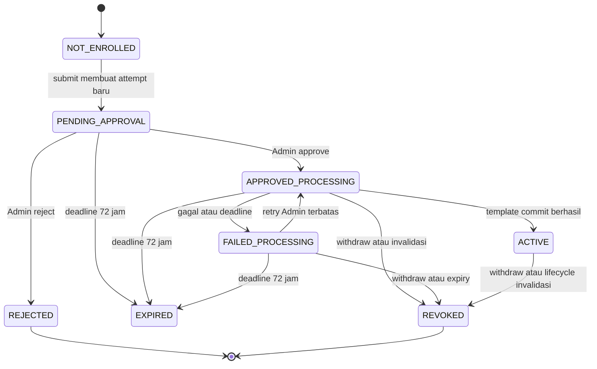

# FL-ENR00 — Face Enrollment V1: proposal arsitektur dan keamanan

**Tanggal proposal:** 24 Oktober 2026. **Status terbaru (26 Oktober 2026, FL-ENR01B): DESIGN APPROVED / SYNTHETIC IMPLEMENTATION AUTHORIZED.** Keputusan dan batas di `DECISIONS.md`; rekomendasi historis bukan approval production. Perubahan mengikat: pending72jam, EXPIRED distinct, encrypted private file, self-consent/withdrawal, satu JPEG immutable dan manual Admin review. Resource/retensi metadata tetap kandidat; notice1 draft sintetis.
**Baseline:** `feat/fl-otp01-email-auth`, HEAD `87bac5e96602e9ff5568069d1c6b1bd1d96913b7`.
**Gate terbaru:** GO backend sintetis/disposable FL-ENR01B; NO-GO wajah manusia/production/migration Product Owner/FL-ENR02 otomatis. Audit FL-ENR00 di bawah tetap historis.

Dokumen ini memenuhi deliverable A–O. Kata **wajib** di bagian desain berarti kewajiban implementasi **jika proposal disetujui**, bukan klaim fitur existing. Angka operasional adalah kandidat terukur, bukan SLA/threshold yang telah tervalidasi. Dokumen kanonik existing tidak diam-diam diganti; daftar perubahan kontraknya ada di §N.

## A. Existing implementation findings — audit read-only

### A.1 Baseline dan cara audit

Branch/HEAD sesuai baseline. Worktree awal hanya memiliki dokumentasi R5: `PROJECT_STATE.md`, `README.md`, `docs/BACKLOG.md`, `docs/EMAIL_OTP.md`, `apps/mobile/assets/video/BACA-SAYA.md`; tidak ada staged file. Semua perubahan itu dipertahankan. SQLite diperiksa hanya melalui SELECT schema/kolom/count: versi migrasi maksimum 4; `people`, `consent_records`, `face_enrollments` masing-masing nol baris; tabel `face_templates` belum ada. Tidak membaca payload wajah, embedding, token, atau key. Tidak memanggil migration runner/startup backend, kamera, SMTP, atau enrollment API.

Hasil R5 dipakai sebagai baseline, **tidak diuji ulang**: OTP login dasar dan logout server terbukti; restore/refresh HP target serta live RBAC 403 masih PARTIAL. Original-hop Gmail DMARC tetap blocker sender-security sign-off. Pemulihan video dan backup preserved bukan bagian perubahan ini.

### A.2 Komponen yang dapat dipakai ulang dan batasnya

| Area / source diperiksa | Fakta existing | Reuse / gap V1 |
|---|---|---|
| `backend/internal/httpapi/router.go:19-74`, `server.go:23-46` | Chi memasang auth, self identity/classes, administrasi user/session/link; tidak ada consent/upload/enrollment/preview/review | Reuse routing/envelope; seluruh handler V1 baru setelah approval |
| `httpapi/auth_middleware.go:53-89`, `authz/authz.go:76-82,149-169`, `authz/sql_directory.go:56-71` | User role/status dibaca ulang; mahasiswa memiliki scope person. Lookup scope belum memeriksa `people.status`; `CanManageBiometrics` admin-only, own-person capability hanya read | Capability self-submit/consent harus terpisah dari Admin review; jangan melebarkan izin Admin ke Mahasiswa |
| `backend/internal/auth/classes.go:240-332`, `migrations/00002_auth_identity.sql:174-179` | Link mahasiswa–person eksplisit oleh Admin, unik satu-ke-satu; invitation tidak membuat person/NIM | Reuse link sah; API pembuatan roster/person belum tersedia, menjadi prerequisite |
| `migrations/00001_init_core_schema.sql:58-74,181-225` | People status dan consent state terpisah. Consent tidak memiliki versi teks. Enrollment CHECK hanya pending/active/revoked/failed; satu active/person | Bukan workflow manual review lengkap; schema desain §E tidak menafsirkan people active sebagai wajah aktif |
| `migrations/00001_init_core_schema.sql:1-7` | `face_templates` dan quality-sample table sengaja belum dibuat | Template encrypted storage belum diimplementasikan |
| `backend/internal/audit/audit.go:40-138`, `httpapi/auth_middleware.go:205-221` | Writer menerima executor transaksi dan memvalidasi metadata; helper HTTP audit best-effort | Reuse writer pada transaksi yang sama dan propagate error; helper best-effort tidak cukup untuk approval/preview/withdrawal |
| `backend/internal/database/db.go:24-36,70-74,116-130,179-215`, `migrations/migrate.go:193-244` | WAL, foreign keys, satu pooled connection, busy timeout 5 s, synchronous NORMAL; migrasi checksummed; checkpoint tersedia | Reuse short transaction/cancellation-safe rollback; jangan menahan koneksi selama upload/inference; deletion orchestrator belum ada |
| `migrations/00001_init_core_schema.sql:249-261` | Struktur idempotency ada, runtime service belum ada | Reuse tabel, implementasikan scope/fingerprint/expiry/atomic replay secara eksplisit |
| `httpapi/server.go:79-86`, `router.go:207-236` | Batas global 1 MiB dan request 15 s | Bukan JPEG decoder, memory budget, upload limiter, atau worker queue |
| `backend/internal/otpkey/*`, `scripts/lib/secure-local.ps1` | DPAPI untuk OTP dan helper DACL tersedia | Hanya pola platform/ACL yang dapat dipakai ulang; **jangan pakai OTP key untuk AES biometrik**. Biometric KeyProvider/AES-GCM belum ada |
| `services/face-engine/face_engine/{detector,embedder,app,gallery,quality,matcher,config}.py` | Prototype webcam desktop, gallery RAM, quality gates dan matching; bukan authenticated service | Reuse Detektor/Embedder saja sesudah approval; lihat §K |
| `apps/mobile/app/(app)/mahasiswa.tsx:25-55,98-111`, `src/features/dashboard/mockData.ts:108-112` | Nama dari session, tetapi persetujuan Aktif literal dan fitur lain fixture | Status enrollment/consent harus datang dari backend; tidak ada bukti consent nyata |
| `apps/mobile/app/(app)/admin.tsx:21-55`, `DashboardShell.tsx:27-80`, `auth/authApi.ts`, `api/client.ts` | Dashboard Admin mock, pintasan alert; shared shell/session/tema tersedia; client diagnostik hanya health | Tambah integrasi terisolasi, jangan memakai demo count sebagai pending count; transport foto/preview belum ada |
| `docs/DECISIONS.md` D-022/D-030, `SECURITY_PRIVACY.md` §5a–5f, `DATA_MODEL.md` §4.12 | Kebijakan AES/DPAPI, kegagalan key dan deletion sudah dirancang | Kebijakan bukan implementasi; manual attendance wajib tersedia sebelum template ditulis |

### A.3 Konflik kontrak yang perlu cutover eksplisit

`API_CONTRACT.md` §5.3/5.4/5.14 dan `AUTHORIZATION.md` §4.4/4.5/4.12 masih admin-only untuk penulisan consent/enrollment, self-service hanya baca. Kontrak lama juga ≥3 quality-accepted samples, masa 10 menit, JPEG transient dan complete otomatis. V1 menggantinya dengan self-consent/submission Mahasiswa, satu foto pending terenkripsi dan review Admin. Ini **perubahan proposal**, bukan endpoint yang sudah ada.

Schema nyata berbeda dari dokumen lama: consent purpose `face_enrollment`, method written/digital_signature/verbal_witnessed, tanpa version; enrollment nyata pending/active/revoked/failed, bukan completed/cancelled/expired dalam `DATA_MODEL.md` §4.10. Gunakan fakta migration sebagai baseline, bukan menyalin DDL dokumentasi yang berbeda. D-030 juga memiliki ketidakselarasan awal periode pemulihan: `DECISIONS.md` butir 7 menghitung dari upaya pemulihan aktif terakhir, sedangkan `SECURITY_PRIVACY.md` §5d.2 dari kegagalan pertama. §N meminta rekonsiliasi; proposal tidak menghapus template hanya karena salah satu timer lewat.

## B. Functional requirements V1

1. Hanya subject dengan `users.role=mahasiswa`, status active, person active/nondeleted yang tertaut sah, dan consent valid dapat mengajukan satu foto kamera depan. Admin/Dosen tidak dapat menjadi subject enrollment, termasuk melalui endpoint Admin.
2. OTP hanya membuktikan kontrol mailbox. NIM/nama roster otoritatif berasal dari person kampus yang dipersiapkan Admin, bukan email suffix atau field bebas dari Mahasiswa.
3. Kamera tidak dimulai sebelum consent tersimpan dan terkonfirmasi server. Menolak consent tidak mengurangi hak absensi manual.
4. Submit menyimpan foto pending **terenkripsi**, bukan template atau keputusan identitas. Tidak menjalankan AI quality/duplicate/liveness sebelum atau sesudah review sebagai gerbang enrollment.
5. Admin melakukan pemeriksaan identitas kampus yang sah dan memberikan attestation tercatat; melihat foto atau menguasai inbox saja tidak cukup. Approve hanya memberi otorisasi pemrosesan foto yang persis ditinjau.
6. ACTIVE hanya sesudah hasil ekstraksi tervalidasi, template AES-GCM tersimpan, dan state/audit berkomit atomik. Approve, active user/person, dan consent granted bukan sinonim ACTIVE enrollment.
7. Rejection memiliki kode alasan aman; foto langsung dihapus logis; pengajuan ulang memakai ID baru, consent baru, dan review baru. Retry teknis hanya memproses foto approved yang sama dan belum kedaluwarsa.
8. Withdrawal memblokir pemakaian saat transaksi commit, menghapus payload DB dalam transaksi itu, dan menjalankan cleanup lanjut yang dapat diamati. Tidak ada penyimpanan foto/embedding plaintext di disk aplikasi/server sebagai workaround.
9. Tidak ada registration tanpa invitation, face enrollment Admin/Dosen, redesign dashboard, perubahan OTP/session/role-assignment policy, Neon, automated approval, duplicate screening, atau liveness dalam V1.
10. Satu foto tidak menjamin akurasi absensi. Threshold pencocokan tetap Q-07 terpisah dan tidak diisi dengan angka demo.

## C. User journeys dan prerequisite roster

**Budi:** Admin mengundang akun melalui mekanisme existing, menyiapkan person/NIM kampus dan link satu-ke-satu secara sah; Budi login OTP, melihat belum terdaftar, memilih **Verifikasi Sekarang**, membaca notice dan menyetujui secara eksplisit, lalu kamera depan mengambil satu foto. Submit sukses menampilkan **Menunggu Verifikasi Admin**. Setelah Admin review, status bergerak ke pemrosesan; hanya template sukses menjadi **Wajah Terdaftar**.

**Belum tertaut:** invitation sendiri tidak cukup. UI menampilkan “Identitas kampus belum ditautkan. Hubungi Admin”; kamera/submit dinonaktifkan. Jangan membuat person atau menghubungkan akun berdasarkan email secara otomatis. §N meminta persetujuan bahwa provisioning roster adalah prerequisite journey, dan §O memasukkan API person/link yang masih kurang, tanpa raw SQL.

**Admin:** count/list pending dari backend → detail nama/NIM, waktu dan status → preview terotorisasi → cocokkan roster dan identitas melalui prosedur kampus → Approve/Reject. Tidak meminta upload foto kartu identitas dalam V1; simpan attestation/reference opaque saja, bukan salinan dokumen.

**Ditolak/gagal:** penolakan identitas adalah keputusan Admin; kegagalan ekstraksi bukan penolakan identitas. UI membedakan alasan aman dan tindakan yang tersedia dari backend. Foto baru selalu menjadi pengajuan baru; foto lama tidak diganti di resource yang sudah disetujui.

**Menolak/menarik consent:** tidak mengaktifkan kamera/pengenalan, tidak menandai absent karena menolak; gunakan absensi manual sesuai kelas/sesi dan audit petugas. Mahasiswa suspended yang tidak dapat login dapat mengajukan withdrawal lewat prosedur kampus dan Admin berwenang, bukan bypass login.

## D. State machine, concurrency, idempotency, dan recovery

### D.1 Empat sumbu terpisah

- Consent: NONE (tidak ada grant), GRANTED atau WITHDRAWN; `notice_version` dan record grant immutable. `people.consent_state` hanya proyeksi, bukan satu-satunya sumber otoritatif.
- Submission: enam state tersimpan di bawah; NOT_ENROLLED adalah hasil turunan ketika belum ada submission, bukan dummy row.
- Identitas: UNREVIEWED / ADMIN_ATTESTED / REJECTED, diturunkan dari keputusan review immutable. ADMIN_ATTESTED bukan verifikasi otomatis atau jaminan identitas absolut.
- Template readiness: true hanya jika template valid/tersedia, consent efektif, subject/link/role masih eligible, dan enrollment ACTIVE. Key tidak tersedia/quarantine membuat readiness false tanpa menghapus ciphertext secara otomatis.

Diagram mewakili satu attempt. REJECTED/EXPIRED/REVOKED terminal; NOT_ENROLLED proyeksi tanpa row. EXPIRED reason PHOTO_RETENTION_EXPIRED tidak memalsukan withdrawal. ACTIVE membutuhkan template aman dan semua guard; key failure mematikan readiness tanpa penghapusan karena diagnosis key-loss.

### D.2 Aturan operasi

| Operasi / actor | Guard dan efek wajib |
|---|---|
| Grant / Mahasiswa | Notice versi kini diterima eksplisit; own person eligible; tidak ada attempt ongoing/ACTIVE. Consent baru setelah rejection/revocation mengganti grant lama secara atomik, menutup record lama, tanpa mewariskan persetujuan |
| Submit / Mahasiswa | Consent baru itu valid dan terikat own person; tidak ada live attempt; key/encrypted storage siap. Resource foto immutable setelah commit |
| Approve / Admin | Pending, foto tersedia/belum expiry, bukan self-review; attestation kampus valid secara prosedural, subject masih eligible. Catat keputusan + job durable dalam transaksi; jangan menunggu Python |
| Reject / Admin | Hanya pending, same version; keputusan immutable, alasan allowlist; hapus foto DB + audit atomik. Tidak boleh Reject ulang saat processing/ACTIVE untuk mengganti histori approval |
| Technical retry / Admin | FAILED_PROCESSING dengan penyebab retryable (**bukan** REVIEWER_INELIGIBLE), approved identity, reviewer asal masih Admin active, foto sama tersedia, consent/epoch masih cocok; belum mencapai batas retry. Kegagalan permanen atau reviewer tidak berwenang butuh foto/consent/review baru |
| Withdrawal / Mahasiswa atau Admin assisted | Revoke semua grant face_enrollment aktif person yang dimaksud, increment epoch, fence jobs, hard-delete photo/template DB dan revoke activation records dalam transaksi yang sama. Tidak perlu key decryption atau If-Match yang dapat menghalangi withdrawal |
| Expiry / sistem | Tolak pemakaian foto segera ketika deadline lewat walaupun sweeper mati; fence processing, revoke attempt nonterminal, purge foto, audit reason PHOTO_RETENTION_EXPIRED; consent tidak ditarik secara fiktif |
| Account/person/link berubah | Tidak dapat digunakan/diaktifkan jika subject bukan mahasiswa active, person inactive/deleted, atau link berbeda. Epoch invalidasi harus menjadi bagian transaksi lifecycle sebelum eligibility dapat dianggap pulih; lihat §E/§O, bukan mengubah algoritme sesi |

At most satu attempt live per person **dan** subject_user_id pada PENDING_APPROVAL/APPROVED_PROCESSING/FAILED_PROCESSING/ACTIVE. Satu activation active/person serta satu template/person pada V1, tanpa multi-model/multi-version aktif. Reenrollment saat ACTIVE ditolak 409; pengguna harus menarik consent, menyelesaikan purge, lalu memberi consent baru. Kebijakan hot-swap tidak termasuk V1.

### D.3 Transaksi dan race

Go menjadi satu-satunya writer. Upload dibaca/di-decode/encrypt dalam budget di luar transaksi; AI dipanggil di luar transaksi. Mutasi memakai transaksi pendek `BEGIN IMMEDIATE` dan CAS revision. Recheck session revocation/expiry, role/status actor dan subject, active person/link, consent, deadline, serta epoch **di dalam transaksi** sebelum commit. Tidak menahan SQLite connection saat pengguna meninjau foto atau saat inference.

Approval/rejection bersamaan: `If-Match` wajib, update pending dengan expected revision, satu row affected; hanya satu keputusan bisa commit, lawan mendapat 412. Dua submit dengan key berbeda ditahan partial unique index dan mendapat 409. Template activation, activation record, submission ACTIVE, penghapusan foto, idempotency result, dan audit harus satu transaksi. Audit gagal → rollback, bukan success tanpa audit. Gunakan `audit.NewWriter(conn, clock)` dan propagate Record error, bukan helper HTTP best-effort.

Job menyimpan attempt_id, expected epoch, revision dan lease deadline. Worker selalu membandingkan semua fence sebelum commit; hasil terlambat setelah withdrawal, relink, expiry, restart/retry, atau job baru dibuang dari memori tanpa template insert. Explicit lifecycle hook baru pada transaksi status/link/person diperlukan untuk increment epoch; tidak mengubah nilai role, kebijakan assignment, OTP atau token logic. Tanpa hook yang terbukti, live lifecycle gate BLOCKED.

### D.4 Idempotency dan retry

Semua POST mutasi memakai `Idempotency-Key` UUID v4. Scope = actor UUID + method + normalized route + target UUID, bukan role/email. Fingerprint mencakup schema version, scope/key, body/consent dan (upload) byte JPEG input, disimpan hanya internal, tidak di log/audit/API, bukan duplicate-face detection. Tidak menyimpan foto di response_body. Key sama + payload beda → 409 IDEMPOTENCY_CONFLICT; key sama + operasi selesai → receipt ID asli dan snapshot status **kini** dengan 200, tanpa mengeksekusi ulang dan tanpa melewati auth/consent/eligibility check. Create pertama 201; approve/retry pertama 202. Receipt withdrawal lama tidak membatalkan consent baru: replay mengembalikan revision receipt serta state kini, UI tidak boleh mengklaim consent kini withdrawn jika sudah ada grant baru.

TTL receipt kandidat 24 jam. Setelah TTL, uniqueness/state/CAS tetap mencegah duplicate effect; jangan menjanjikan replay byte-identik tanpa batas. Jika response hilang, client query own status dan retry key/body yang sama; setelah app restart jangan menebak sukses atau mengunggah foto baru otomatis. Tidak mengirim ulang POST lewat generic network retry secara buta.

Processing di background, satu job aktif, satu bounded worker, queue kandidat maksimum 10. Deadline satu extraction 10 s, lease 30 s. Setelah restart/lease lewat, job lama ditandai failed secara persisten, tidak kembali pending selamanya. Kandidat maksimum tiga attempt termasuk pertama, **tanpa auto-retry inference**; Admin explicit retry transient failure. Retry tidak memperpanjang photo TTL. Permanent NO_FACE/MULTIPLE_FACES/EXTRACTION_FAILED bukan AI identity rejection; buat foto baru/review baru. Native inference mungkin tidak berhenti saat HTTP cancel: worker harus dibatasi proses/memori dan fence late results; thread safety OpenCV belum terbukti.

## E. Data model proposal — bukan DDL/migration

### E.1 Pilihan penyimpanan

| Opsi | Kelebihan | Risiko / keputusan |
|---|---|---|
| **Encrypted photo BLOB di tabel terpisah — direkomendasikan** | Commit foto+submission+audit atomik, deletion DB atomik; satu writer, demo 5–10 orang | Membesarkan DB/WAL dan ikut raw backup; perlu strict retention/cleanup dan batas disk. Ini pengecualian baru kebijakan photo persistence, menunggu approval |
| Encrypted local file + opaque reference | DB lebih kecil, file mudah dikelola terpisah | DB/file commit tidak atomik; perlu staging ciphertext, orphan recovery, ACL non-synced directory, deletion reconciliation, private streaming. Jangan pakai path/nama NIM atau static URL |

Tidak menyimpan gambar pada quality-sample table lama atau mencampurkannya dengan embedding di `face_templates`. Jika encrypted BLOB tidak disetujui, **jangan** menurunkan ke plaintext/temp file atau mengklaim pending review tahan restart.

### E.2 Entitas dan constraint yang diusulkan

Semua ID UUID v4; waktu RFC3339 UTC `Z`; FK nonbiometrik RESTRICT bila historinya masih diperlukan. Ini daftar field/constraint desain, tidak dijalankan.

| Entitas | Field / constraint proposal |
|---|---|
| `people` existing | Reuse external_code sebagai NIM/kode kampus otoritatif dan account_user_id unik. Tambah monotonic `biometric_epoch` integer untuk invalidasi; jangan menyamakan `status=active`/consent_state dengan template readiness. Source NIM dan kebijakan perubahan/reuse kode kampus perlu disepakati |
| `consent_records` existing + extension | Reuse purpose `face_enrollment`, status granted/withdrawn dan unique grant/person/purpose. Tambah `notice_version`, `notice_digest`, `subject_user_id`, `withdrawn_by`, `withdraw_reason_code`. `recorded_by` saat self-grant = subject; server menentukan timestamps. Method baru `digital_explicit` memerlukan revisi CHECK melalui migration baru yang direview; jangan menyebut klik consent sebagai digital signature kriptografis. Notice canonical immutable di repo/config, perubahan versi meminta consent baru |
| `face_enrollment_submissions` baru | id, person_id, subject_user_id, consent_id, previous_submission_id nullable, status enam state tersimpan, submitted_at, photo_expires_at, revision integer, captured_epoch, review_decision nullable, reviewer_admin_id, reviewed_at, identity_check_method, identity_attestation_version, campus_check_ref opaque nullable sesuai SOP, rejection_reason_code, processing_error_code, activated_enrollment_id nullable unique, revoked_at/reason_code, created_at/updated_at. FK memastikan consent/person/subject cocok melalui composite uniqueness/FK plus domain checks |
| Submission uniqueness | Partial unique/person dan unique/subject untuk empat state live di §D; review decision/time/reviewer wajib bersama. ACTIVE membutuhkan approved decision dan activation reference. Terminal attempts immutable, kecuali metadata deletion nonbiometrik |
| `face_enrollment_photos` baru | submission_id PK/FK, ciphertext BLOB, nonce 12 byte, auth_tag 16 byte, algorithm AES-256-GCM, key_version TEXT, aad_version, aad, canonical_mime image/jpeg, width/height, plaintext_byte_length, expires_at. Satu foto/attempt; unique key_version+nonce dalam namespace key foto, batas ciphertext+tag terukur. Secure photo reference adalah submission_id internal, bukan path/URL |
| `face_enrollments` existing | Dipakai sebagai **activation/model record**, dibuat hanya saat template sukses dengan status active dan sample_count=1; bukan state review kedua. Reuse model_name/version/checksum, enrolled_at, created_by reviewer. Pada withdrawal record revoked dan template dihapus; tidak menyimpan foto. Kontrak public submission_id berbeda dari activation_enrollment_id; jangan expose alias membingungkan |
| `face_templates` baru, sesuai D-022 | id, person_id, activation_enrollment_id UNIQUE, consent_id, ciphertext, nonce, auth_tag, aad, algorithm, key_version TEXT, embedding_dim=128, dtype float32-le, model_id/version/checksum, detector_id/version/checksum, pipeline_revision, created_at. Unique person pada V1 (lebih ketat daripada unique person/model lama); tidak ada embedding plaintext atau template read API |
| `enrollment_processing_jobs` baru | submission_id UNIQUE, attempt_id UUID, attempts_started, expected_revision/epoch, state queued/running/finished, lease_until, last_error_code. Queue durable metadata saja; tidak membawa image/vector. Job retry tidak dapat mengeksekusi attempt_id lama |
| `biometric_deletion_jobs` baru | person_id, requested_at, reason_code, state PENDING/COMPLETE/FAILED, db_payload_removed_at, cleanup checkpoints, completed_at, last_error_code. Ini lifecycle operasional, bukan tambahan state enrollment. Tanpa image/key/path privat di UI |
| `idempotency_records`, `audit_events` existing | Reuse kolom aktual scope/key/request_hash/response_code/response_body/expires_at dan occurred_at/actor/action/result/entity/request_id/metadata_json. Enrollment audit dalam transaksi; response_body receipt minimal tanpa payload/salinan NIM/alasan bebas |
| Rate buckets baru | Subject/action/window/counter/expiry, unique scope+window; fixed window transactional. Tidak memakai bucket OTP agar tidak mengubah limit login |

CHECK lintas tabel tidak diasumsikan tersedia di SQLite: integritas kombinasi ditangani composite FK/unique constraint yang memungkinkan dan service transaction/CAS, dengan tes concurrency. Aturan role dan status **tetap** diperiksa Go, bukan hanya FK. Applied migrations 00001–00004 tidak diedit; nomor migrasi baru dipilih saat implementasi setelah memeriksa HEAD saat itu. Tidak ada migration file pada proposal ini. Future status/link lifecycle harus menaikkan epoch dan fence work pada transaksi yang sama; existing best-effort audit/link tidak otomatis memenuhi kontrak baru.

### E.3 Portabilitas Neon masa depan

UUID/logical IDs dan UTC tetap; representasi BLOB → bytea, FK/partial unique index dan CAS dirancang terpisah dari SQL driver. SQL SQLite BEGIN IMMEDIATE nantinya diganti transaksi/locking PostgreSQL yang setara, bukan port sintaks buta. Encryption format/AAD tidak memasukkan path DB/rowid agar ciphertext tetap dapat diverifikasi setelah migrasi. DPAPI CurrentUser adalah kebijakan Windows lokal, **bukan** key management Neon/cloud. Pemindahan foto/template/key keluar mesin memerlukan review privasi, auth service, key custody, backup/retention dan keputusan terpisah. Tidak memakai Neon atau mengirim data ke cloud sekarang.

## F. REST API contract proposal

### F.1 Konvensi yang berlaku untuk setiap endpoint

Seluruh path berawalan `/api/v1`; HTTPS tervalidasi, opaque Bearer session existing, role/status actor dibaca ulang. Salah role 403 FORBIDDEN_ROLE sebelum lookup object; tidak ada credential/expired/revoked/suspended 401 memakai error auth existing. Kegagalan ownership/resource yang relevan 404, own-account belum linked 409 ACCOUNT_NOT_LINKED. Tidak memakai email suffix atau body user_id/person_id pada `/me/*`; unknown fields/query ditolak 400. Tidak menerima keputusan review, template, model atau role dari Mahasiswa.

Sukses memakai `{data,request_id}`, daftar `{data,page:{next_cursor,has_more,limit},request_id}`; extension summary hanya jumlah pending. Error existing `{error:{code,message,request_id}}`, tanpa payload, paths atau stack. Semua respons authenticated `Cache-Control: no-store`; query list cursor opaque, default 20/max 50, urut submitted_at,id; tidak memakai count fixture. Browser/CORS/cookie auth tidak diaktifkan.

Common errors: 400 VALIDATION_FAILED; 401 auth; 403 role; 404 NOT_FOUND; 409 conflict; 412 PRECONDITION_FAILED untuk stale If-Match; 413 IMAGE_TOO_LARGE; 415 UNSUPPORTED_MEDIA_TYPE; 422 domain/image; 428 PRECONDITION_REQUIRED untuk mutation review tanpa If-Match; 429 RATE_LIMITED + Retry-After; 500 INTERNAL_ERROR; 503 DATABASE_BUSY/AUDIT_UNAVAILABLE/BIOMETRIC_UNAVAILABLE. Tidak semua endpoint memerlukan key: status, consent withdrawal dan cleanup harus tetap bekerja saat key gagal. Key/AI error tidak mengubah keberhasilan login atau absensi manual.

POST membutuhkan idempotency §D.4; approve/reject/retry membutuhkan If-Match dari Admin detail. Consent grant memakai If-Match dari own consent/aggregate agar penggantian grant tidak menimpa tab lain. Withdrawal sengaja tidak menuntut If-Match; replay receipt tetap mengikuti §D.4. Recheck authorization mendahului idempotency lookup. GET aman diulang, tetapi preview tetap diaudit setiap akses yang diotorisasi.

### F.2 Schema DTO bersama

- `ConsentView`: `{state:NONE|GRANTED|WITHDRAWN, record_id:UUID|null, notice:{version,digest,text}, granted_at:UTC|null, withdrawn_at:UTC|null, revision:int}`. Teks notice current tidak diubah setelah diterima; digest mengikat bukti versi, bukan biometric fingerprint.
- `OwnEnrollmentView`: `{effective_status, submission_status:null|state, submission_id:UUID|null, consent_state, identity_state, template_ready:bool, submitted_at:UTC|null, reviewed_at:UTC|null, processing_deadline:UTC|null, reason_code:null|string, deletion_state:NONE|PENDING|COMPLETE|FAILED, revision:int, allowed_actions:string[]}`. Tidak ada foto, NIM orang lain, reviewer-private evidence, embedding atau key. Backend menghitung actions; offline/unavailable bukan NOT_ENROLLED atau ACTIVE.
- `AdminEnrollmentView`: OwnEnrollmentView + `{student:{user_id,person_id,display_name,external_code}, photo_available:bool, photo_expires_at, review:{reviewer_admin_id,decision,at,identity_check_method,campus_check_ref}|null, history:[{audit_id,action,actor_id,time,reason_code}]}`. Detail hanya Admin, history enrollment/preview/cleanup yang relevan; bukan akses audit global bebas. Nama/NIM join dari roster, tidak disalin ke log/audit.
- `MutationReceipt`: `{operation_id, resource_id, applied_revision, current:OwnEnrollmentView|AdminEnrollmentView}`; replay menunjukkan current state, bukan status ACTIVE historis yang sudah revoked. Photo GET pengecualian binary sukses; error sebelum byte pertama tetap JSON.

### F.3 Endpoint-by-endpoint

| ID / method dan path | Role dan input | Output/status sukses | Validasi/domain error tambahan | Audit dan idempotency |
|---|---|---|---|---|
| API-01 `GET /me/consent` | Mahasiswa; tanpa body/subject query | 200 ConsentView + ETag | Own person active; no grant → NONE, bukan error. Linked-person lifecycle invalid → 409 SUBJECT_INELIGIBLE | Read tidak mengubah consent; no mutation audit; GET repeatable |
| API-02 `POST /me/consent` | Mahasiswa; JSON `{notice_version:string,accepted:true,replaces_consent_id?:UUID}` | 201 ConsentView/receipt + ETag; replay 200 | Versi exact current ≤64 chars; true eksplisit; 409 CONSENT_VERSION_MISMATCH/CONSENT_CONFLICT/ENROLLMENT_EXISTS. Penggantian hanya setelah attempt terminal dan payload lama sudah dipurge | consent.granted; bila mengganti juga consent.withdrawn reason REPLACED_BY_NEW_GRANT; atomic idem + If-Match |
| API-03 `POST /me/consent/withdraw` | Mahasiswa; JSON `{scope:"ALL_FACE_ENROLLMENT",confirmed:true}` | 200 receipt + own current; deletion_state pending bila cleanup fisik belum selesai | Operasi revoke semua grant efektif subject saat request pertama, tanpa key; no active grant → no-op receipt. Repeated request tidak menulis audit withdrawal ganda | consent.withdrawn, enrollment.revoked, template.deleted/photo.deleted (count), deletion.requested dalam transaksi; idem, tanpa If-Match |
| API-04 `GET /me/face-enrollment` | Mahasiswa; tanpa ID/body | 200 OwnEnrollmentView + ETag | Tidak ada attempt → NOT_ENROLLED. Unlinked 409; koneksi gagal bukan state bisnis. Tidak mengembalikan data orang lain | GET repeatable, tanpa state mutation |
| API-05 `POST /me/face-enrollment-submissions` | Mahasiswa; binary image/jpeg; bounded Content-Length; header `X-Consent-Id:UUID`, Idempotency-Key | 201 receipt/current PENDING_APPROVAL, Location `/api/v1/me/face-enrollment`; replay 200 | Foto sesuai §G; consent exact milik subject/current version. 422 CONSENT_REQUIRED/CONSENT_WITHDRAWN, 409 ENROLLMENT_EXISTS/DELETION_INCOMPLETE/SUBJECT_INELIGIBLE, 413/415/422 IMAGE_DECODE_FAILED; key/storage unavailable 503, quota 429. Tidak ada inferensi AI | enrollment.submitted + count, photo cipher + idem commit; foto immutable |
| API-06 `GET /face-enrollment-submissions` | Admin; `status?` enum, cursor?, limit? | 200 list ringkas `{id,student:{display_name,external_code,person_id},status,submitted_at}` + page + `summary:{pending_count}` | Invalid filter/cursor 400; count current pending saja, foto tidak di-list. Batas list dan audit rate | enrollment.queue_read count; repeatable, tidak audit NIM/nama/filter bebas |
| API-07 `GET /face-enrollment-submissions/{id}` | Admin; UUID v4 | 200 AdminEnrollmentView + ETag | 404 unknown, person/privacy inaccessible; detail memuat history terbatas dan foto available flag, tidak bytes | enrollment.review_opened; GET repeatable |
| API-08 `GET /face-enrollment-submissions/{id}/photo` | Admin saja; UUID; tidak menerima URL/path | 200 canonical image/jpeg; Content-Length, no-store, nosniff; private memory preview | Hanya foto retained, consent/subject eligible dan ID cocok. 410 PHOTO_UNAVAILABLE untuk resource yang Admin boleh tahu tetapi foto sudah dihapus/expired; 503 key/integrity/audit failure. Range/download/query token tidak didukung | photo.preview_authorized dikomit **sebelum** stream. Jika audit gagal tidak ada byte; audit ini izin akses, bukan bukti manusia benar-benar melihat. Setiap GET diaudit, tidak public/signed URL |
| API-09 `POST /face-enrollment-submissions/{id}/approve` | Admin; JSON `{identity_check_method:"CAMPUS_ROSTER_IN_PERSON"|"CAMPUS_AUTHORIZED_CHECK",attestation_version:string,confirmed:true,campus_check_ref?:UUID}` | 202 receipt/current APPROVED_PROCESSING; replay 200 | Pending only, foto belum expiry, SOP/method/ref sesuai kebijakan kampus; bukan reviewer sendiri; 409 INVALID_TRANSITION/PHOTO_UNAVAILABLE/SUBJECT_INELIGIBLE/QUEUE_FULL, stale 412. Queue durable dibuat atomik; tidak menjanjikan ACTIVE | enrollment.approved + processing.queued, reviewer/time/attestation persisted, idem+If-Match |
| API-10 `POST /face-enrollment-submissions/{id}/reject` | Admin; JSON `{reason_code:"IDENTITY_MISMATCH"|"EVIDENCE_INSUFFICIENT"|"UNSUITABLE_SUBMISSION"}` | 200 receipt/current REJECTED | Pending only; no bebas-text/diagnosa/NIM di alasan; 409 INVALID_TRANSITION, 412 stale; photo delete atomik | enrollment.rejected, photo.deleted, deletion.requested; idem+If-Match |
| API-11 `POST /face-enrollment-submissions/{id}/retry-processing` | Admin; JSON `{confirmed:true}` | 202 receipt/current APPROVED_PROCESSING; replay 200 | Failed approved same photo, transient retryable error (**bukan** REVIEWER_INELIGIBLE), reviewer asal masih Admin active, consent/epoch valid, foto belum expiry, attempts<3; 409 RETRY_NOT_ALLOWED/RETRY_EXHAUSTED/PHOTO_UNAVAILABLE/QUEUE_FULL, 412 stale. Tidak mengubah keputusan review dan tidak mengganti reviewer | processing.retry_requested + queued; attempt baru, idem+If-Match |
| API-12 `POST /people/{person_id}/consent/withdraw` | Admin assisted; JSON `{scope:"ALL_FACE_ENROLLMENT",confirmed:true,request_method:"CAMPUS_STUDENT_REQUEST",request_ref:UUID}` | 200 receipt/current; cleanup status | Person known, student-request tervalidasi melalui SOP, tidak memberi consent atas nama mahasiswa; 404 unknown, 422 invalid evidence ref. Dapat membantu subject suspended tanpa membuka login subject | consent.withdrawn reason STUDENT_ASSISTED_REQUEST + events purge seperti API-03; idem, tanpa If-Match |

Tidak ada POST reenrollment khusus: setelah terminal/purge, API-02 consent baru + API-05 ID baru. Admin tidak memiliki endpoint submit foto subject atau mengaktifkan template secara langsung. Tidak memasang endpoint samples/complete lama sebagai compatibility shim; proposal cutover kontrak unimplemented lama harus direview dahulu. General errors/status §F.1 berlaku pada setiap baris, termasuk audit-failure fail-closed pada Admin reads yang diaudit. Angka/error baru adalah proposal API, bukan kode existing.

## G. Security/privacy threat model dan image safety

| Ancaman | Boundary/mitigasi V1 | Residual / acceptance |
|---|---|---|
| Akun mailbox dibajak/shared inbox | OTP unchanged; role/scope DB, manual campus identity check wajib | Mailbox bukan identitas dunia nyata; DMARC original-hop belum aligned, tetap blocker sign-off |
| IDOR / confused deputy / approval Mahasiswa | `/me` server-resolved, Admin role before object lookup, device/Dosen ditolak; subject harus mahasiswa, reviewer bukan subject | Cross-role live 403 belum dibuktikan R5; tes V1 wajib |
| Foto palsu/screenshots/deepfake / wajah ganda | SOP pertemuan kampus/registrar dan attestation; satu foto reviewed immutable; sesudah approve technical detector count tepat satu | Tidak ada liveness/duplicate check; tidak dapat membuktikan foto berasal kamera depan dari JPEG saja |
| Malicious JPEG / decompression bomb | MIME+magic+header/decode nyata, batas encoded/decoded, concurrency, deadline, no path/ZIP/URL/HEIC/SVG | CV/library decoder tetap dependency risk; updates/sandbox/resource cap harus dibuktikan |
| Replay/race/double approval | Scoped idem, CAS/unique constraints, durable job+epoch fencing, audit atomic | Cancel socket tidak menjamin inference berhenti; late output harus ditolak |
| Kebocoran disk/log/backup | AES-GCM pending dan template, key di luar DB, DACL, no raw request/response tracing, non-synced data dirs, §H cleanup | DPAPI tidak melindungi dari proses/malware akun Windows yang sama, paging/dump/SSD remanence tetap risiko |
| Admin curiosity / preview scraping | Preview hanya Admin assigned secara operasional, short-lived fetch dengan auth server, no-store/no public URL, audit sebelum bytes, per-Admin limit | Admin sah dapat memotret layar dengan perangkat lain; minimisasi dan SOP tetap diperlukan |
| Penolakan biometrik merugikan mahasiswa | Manual attendance setara, tidak ada absent karena no consent atau processing failure | Manual API masih belum ada; prerequisite implementasi/live gate, bukan klaim tersedia sekarang |

**Image envelope kandidat:** JPEG tunggal ≤1,048,576 byte (batas existing), width/height 112–1920 px, maksimum 2,073,600 pixel; JSON field ≤64/128 chars sesuai DTO, body JSON baru ≤16 KiB. 112 adalah batas teknis image minimum, bukan score kualitas wajah. Angka harus diuji pada HP/laptop sebelum disahkan. Content-Length wajib pada upload V1; jika klien native tidak dapat menyediakannya, perubahan kontrak streaming perlu review, bukan bypass limiter. Tidak meningkatkan limit global/auth supaya upload lolos.

Urutan: autentikasi/authorize/rate guard → bounded read (termasuk chunked/lying length) → MIME dan marker JPEG/format allowlist → DecodeConfig/dimensi sebelum alokasi besar → bounded decoder → orientasi EXIF tervalidasi, tanpa mirror tersimpan → re-encode JPEG canonical tanpa EXIF/GPS/comment/thumbnail/ICC tidak diperlukan → validasi ulang batas → encrypt → transaksi/recheck. Original bytes dibuang dari memori; tidak ke temp disk. Tidak menjalankan blur/brightness/pose/face-size/scoring/duplicate/liveness. Preview dan extraction memakai canonical photo yang **sama**, bukan image render berbeda setelah approval.

Budget kandidat: 2 upload decode simultan; worker inference 1; satu upload body ≤1 MiB dan decoded RGB ≤6,220,800 byte, dengan budget working memory per proses yang juga mencakup decoder/model copies (bukan hanya satu buffer). Limit submit 3/jam dan 10/hari per subject; 30 upload/jam backend; 100 MiB total ciphertext foto pending, tidak menghitungnya sebagai kapasitas seluruh disk. Jika storage/queue penuh → 429/409 terukur, jangan evict pending diam-diam. Preview 30/menit/Admin dan satu stream aktif/Admin; 429 untuk kelebihan. Batas foto/disk dihitung ulang dalam transaksi untuk race. Rate buckets enrollment terpisah dari OTP; detail IP tidak menjadi identitas/ownership.

Session expiry/suspension saat upload/decision: commit ditolak dan buffer dibuang; jika mutation sudah commit tetapi response hilang, idem/status menentukan hasil. Logout Admin setelah approval tidak membatalkan keputusan durable yang sudah sah; worker tetap memeriksa subject/consent/person dan reviewer masih berwenang sebelum aktivasi. Jika reviewer tidak lagi Admin active, stop ke FAILED_PROCESSING dengan REVIEWER_INELIGIBLE yang **tidak retryable**. Mahasiswa dapat menarik consent, menyelesaikan purge, lalu mengajukan foto/consent baru untuk review Admin yang sah. Tidak ada re-attestation tersembunyi lewat technical retry, reassignment endpoint, atau activation otomatis jika reviewer kembali aktif.

## H. Consent, key management, retention dan deletion

### H.1 Notice dan bukti consent

Notice Bahasa Indonesia harus menyebut pengelola/kontak kampus, tujuan absensi satu kelas, satu foto pending/reviewer Admin/pemrosesan lokal YuNet/SFace, template terenkripsi, daftar akses, angka retensi yang disetujui, risiko spoofing/kesalahan, withdrawal dan batas physical erasure, tidak ada LLM/cloud, serta absensi manual setara. Tidak ada checkbox checked by default atau consent disatukan dengan syarat login. Notice version+digest+actor+server time mengikat tindakan affirmative; server menolak versi usang. Penerimaan consent bukan tanda tangan kriptografis atau verifikasi kampus otomatis. Perubahan tujuan/versi memerlukan grant baru; tidak memigrasikan consent lama diam-diam.

### H.2 Encryption dan key failure

AES-256-GCM application-level untuk photo dan template; nonce crypto/rand 12 byte, tag 16 byte, unique per encryption pada key namespace/version; nonce collision ditolak dan regenerate, tidak reuse saat overwrite/retry. Template AAD mempertahankan field D-022 `(person_id,model_id,model_version,key_version)` dengan encoding canonical tidak ambigu, diverifikasi dari trusted fields. Proposal encoding UTF-8 length-prefixed (length:uint32 big-endian + bytes per field), field order tersebut; implementasi belum memiliki format deployed. Jangan menambah/mengubah field AAD locked template tanpa approval. Photo AAD baru mengikat purpose `pending-photo`, aad_version, person_id, subject_user_id, submission_id, consent_id, mime, key_version dengan encoding yang sama. AAD bukan rahasia, tetapi tidak dipakai untuk menerima relabel arbitrary dari request.

Usulkan dua key namespace terpisah, `template` dan `pending-photo`, masing-masing key AES 32 byte dan versi awal TEXT `'1'`. KeyProvider Go satu pintu; material disiapkan operator secara eksplisit, dibungkus DPAPI CurrentUser di `%LOCALAPPDATA%\FaceLink\keys\`, di luar DB/Git/OTP secrets. DACL minimum user pemilik; SYSTEM Read bila kebijakan lingkungan disetujui; bukan Everyone/Users, tidak meminta admin elevation. Perbedaan ACL dokumen biometrik “user-only” dan helper OTP “user+SYSTEM” harus diputuskan §N, bukan diwariskan tanpa izin. Python hanya memiliki credential service-auth, **tidak** memiliki AES keys/KeyProvider/DB.

Tidak ada default/fallback key atau auto-key generation. Foto/template key failure menutup operasi terkait; withdrawal/status/auth/manual tetap dapat berjalan aman. A: key sementara inaccessible → preserve ciphertext. B: tag/AAD/key mismatch → quarantine, readiness false, preserve dan investigasi. C: kehilangan pasti → operator-led disposal hanya sesudah syarat D-030 dan periode konservatif terpenuhi; bukan cron otomatis. Sampai konflik awal timer diselesaikan, gunakan batas yang tidak lebih awal dari **kegagalan pertama +30 hari dan upaya pemulihan aktif terakhir +30 hari**, plus seluruh investigasi dan persetujuan operator. Ini guard konservatif proposal, bukan perubahan keputusan final. Withdrawal pemilik data tidak ditunda karena insiden key/30 hari; deletion tidak memerlukan decrypt. Tidak ada key rotation sekarang; format versioned menyiapkan rotasi terpisah.

### H.3 Retensi yang direkomendasikan, menunggu approval

| Data | Retensi proposal / pemicu |
|---|---|
| Foto pending | **72 jam** sejak penerimaan pertama backend; retry/preview/approval tidak memperpanjang; expiry langsung menutup preview/approve/processing walau scheduler mati |
| Foto approved/failed | Hapus setelah ACTIVE; reject/withdraw/invalidasi dan processing failure purge konservatif segera. Tidak ada retention retry baru; setelah purge perlu grant/submission/review baru |
| Template | Selama consent aktif dan demo masih memerlukannya; deadline penghapusan akhir demo harus ditetapkan kalender sebelum capture, kandidat paling lambat 24 jam setelah demo selesai |
| Consent, keputusan/reason code, audit, job receipt tanpa biometrik | Kandidat 90 hari setelah penutupan demo untuk pertanggungjawaban lalu maintenance terotorisasi; harus diselaraskan dengan retensi kehadiran kampus/D-030 sebelum disahkan |
| Idempotency | 24 jam, tanpa gambar/embedding; constraint domain tetap sesudah receipt expired |
| Capture/preview memory | Sampai transfer/render perlu, dibuang saat cancel/navigasi/background/logout; tidak gallery/persisted upload queue/body dump |

**Tidak ada jaminan forensik.** Usulan V1 tidak membuat backup foto pending. Raw copy SQLite otomatis juga menyalin BLOB/WAL; karena itu backup generik tidak boleh dianggap mengecualikan foto. Rekomendasi demo: tidak ada backup payload biometrik; jika backup nonbiometrik diperlukan gunakan export terkontrol yang menghilangkan photo/template tables, bukan copy file DB. Tool export ini belum ada; sebelum tersedia, jangan membuat backup DB yang memuat payload. OS snapshot/cloud sync/antivirus dump inventory perlu dikonfirmasi operator.

Recovery DB dari salinan lama tidak boleh menghidupkan kembali consent/template yang sudah dicabut. Pada restore, biometric readiness off sampai revocation/retention direkonsiliasi dengan catatan terbaru yang independen; bila tidak tersedia, tetap manual dan minta keputusan insiden pemilik atas purge payload restore/fresh consent/reenrollment. Jangan menghapus ciphertext otomatis karena key belum ditemukan, dan jangan menganggap backup berisi current consent. Kebijakan disaster recovery ini perlu approval dan runbook; tidak ada silent reactivation.

### H.4 Deletion lifecycle yang dapat diamati

1. Transaksi withdrawal/reject/expiry: persist consent/revocation jika relevan, increment epoch, fence job, delete photo/template payload DB yang terkena, revoke activation; audit + deletion job PENDING atomik. Withdrawal juga membersihkan semua grant lama efektif untuk purpose ini. Jangan soft-delete template sebagai pengganti withdrawal.
2. Processing result/in-memory frame/crop/vector dibuang; fetch preview dan capture dibatalkan, tidak mengirim bytes baru setelah revocation commit. Byte yang telah diterima Admin tak dapat ditarik kembali. Cache pada client/backend/worker yang dikendalikan dihapus.
3. Cleanup worker mengikuti prosedur D-030: checkpoint WAL truncate dengan pembaca terkendali, VACUUM di luar transaksi bisnis, known backups/WAL/SHM dan cache terkait ditangani. Busy/error → retry operasional bounded dan state FAILED setelah 24 jam, alert operator; data tetap tidak eligible. Backend mati tidak menghilangkan job; startup tidak mengaktifkan biometrik dari job yang belum reconciled.
4. COMPLETE hanya jika langkah yang dapat dikendalikan diverifikasi dan audit completion tersimpan. Lokasi tidak terjangkau tetap dicatat sebagai keterbatasan/FAILED, tidak dilabel terhapus penuh. Jangan menghapus attendance/audit/identitas nonbiometrik. SSD remanence/OS paging/remote screenshot tidak dijamin hilang.
5. Cleanup karena key-loss C tetap operator-authorized menurut D-030, berbeda dari withdrawal/retensi yang sudah disetujui. Jadwal gagal tidak boleh menghalangi withdrawal seketika atau absensi manual.

## I. Admin authorization dan prosedur approval

Backend mengecek sesi, Admin active dan subject mahasiswa active/person/link/consent setiap list/detail/preview/decision. “Admin” sebagai reviewer tidak berarti boleh menjadi biometric subject. Tidak ada approval client Mahasiswa, dedicated hardcoded tester, atau bypass internal lewat suffix. Reviewer tidak boleh subject sendiri. Menampilkan foto butuh preview authorization dan audit terpisah dari review_opened.

SOP proposal: Admin roster officer cocokkan NIM/person/user dengan roster resmi; lakukan pemeriksaan langsung kartu mahasiswa **tanpa menyimpan fotokopi** atau prosedur registrar aman yang disahkan kampus; cocokkan orang yang diperiksa dengan foto pending; baca/centang attestation versi server dan pilih method. Reference bukti hanya ID tiket opaque bila tersedia/disyaratkan SOP; tidak menaruh nomor identitas, diagnosa, atau dokumen di reason/audit. Server membuktikan siapa menyatakan apa dan kapan, **tidak** dapat membuktikan sendiri bahwa Admin benar-benar melakukan pemeriksaan; residual human-error/fraud diterangkan kepada pemilik.

Decision immutable; kesalahan approval yang sudah diproses tidak diedit menjadi rejection. Gunakan withdrawal/revocation terotorisasi dan pengajuan baru. Record reviewer + method + attestation + waktu + audit pointer tersimpan bersama keputusan; mahasiswa hanya menerima safe reason code dengan teks lokal yang tidak menyebut mahasiswa lain. Setelah error teknis, Admin melihat failed state dan retry_allowed dari server, bukan tombol Approve berulang.

## J. Mobile dan Admin UX integration contract

Tidak mengubah grid/tema/branding/video/login/dashboard role layout. Pakai shell, komponen status/tombol existing dan session provider; feature client baru tidak memakai client diagnostik seolah sudah mendukung upload. Credential tetap melalui akses sesi existing, tidak disalin ke log/AsyncStorage. Nonbiometric fixture lain tetap dilabel demo, tidak ikut dianggap live karena satu kartu enrollment sudah terintegrasi.

| Kondisi backend | Tampilan/tindakan minimal Mahasiswa |
|---|---|
| NOT_ENROLLED, eligible | “Wajah belum terdaftar” + Verifikasi Sekarang |
| Consent NONE / versi perlu diperbarui | Notice, pilihan setuju/tidak; tidak ada kamera sebelum server grant confirmed |
| Account belum linked / status load gagal | Hubungi Admin / Tidak dapat memuat status, retry; jangan tampilkan Aktif palsu |
| Upload in flight | Progress determinate jika transport mendukung, cancel; batas 15 s, setelah timeout query status/idem, bukan spinner selamanya |
| PENDING_APPROVAL | Menunggu Verifikasi Admin, waktu submit; tidak memperlihatkan photo URL atau duplicate submit |
| REJECTED | Kode alasan aman diterjemahkan + pengajuan baru dengan consent baru setelah purge |
| APPROVED_PROCESSING | “Foto disetujui; template sedang disiapkan”, deadline. Poll/reload; jika deadline lewat tampilkan status belum terkonfirmasi dan query server, tidak menetapkan ACTIVE/FAILED sendiri |
| FAILED_PROCESSING | Pesan teknis aman; retry hanya jika server mengizinkan actor terkait, atau Hubungi Admin/ambil ulang setelah consent baru |
| ACTIVE + template_ready true | Wajah Terdaftar; consent dan template terpisah; bukan janji anti-spoofing/accuracy |
| REVOKED / readiness false | Tidak aktif / Template sementara tidak tersedia sesuai reason; status deletion dan manual fallback; tidak mengaktifkan kamera otomatis |

Status fetched saat focus/relaunch dan setelah mutation; polling kandidat 5 s saat foreground pending/processing, berhenti saat background/logout/offline, exponential network delay maksimum 30 s. ETag/version untuk conditional reads hanya pada metadata; enrollment summary boleh memuat no-store dengan ETag untuk validasi fresh response. Preview binary tetap no-store tanpa URL token/cache. Client belum terbukti dapat menghentikan spinner/polling/refresh pada semua lifecycle; uji §L wajib.

**Capture privacy blocker:** dependency kamera belum ada di mobile. Jangan mengasumsikan `base64:true` berarti Expo tidak menulis cache. Desain strict memilih in-memory front-camera capture + bounded upload adapter, tanpa gallery/disk file; feasibility Expo SDK 58/native PictureRef/transport harus dibuktikan. Jika API kamera yang dipilih selalu menulis plaintext cache, itu **BLOCKED**, bukan diizinkan diam-diam: perlu adapter native memory-only atau exception baru yang eksplisit dari pemilik (tidak direkomendasikan sebagai default). Tidak menyebut kemampuan API yang belum diaudit sebagai sudah tersedia.

Admin menambah count pending, shortcut/list/detail minimal, preview memory-only, Approve/Reject, dan riwayat terbatas. Hindari image-loader yang menyimpan ke disk walau HTTP no-store; tidak prefetch semua foto. Preview ditutup/cleared pada background/logout; rekomendasikan FLAG_SECURE khusus layar biometrik, bukan perubahan global. Disable payload network inspector, analytics/crash attachments dan body tracing sebelum foto nyata; development build yang merekam request body tidak aman untuk biometrik. Ini bukan perlindungan dari kamera eksternal atau OS kompromi. Restart saat pending memuat ulang metadata, bukan mengaktifkan ulang kamera atau mengirim file tersembunyi.

## K. YuNet/SFace integration plan

### K.1 Reuse yang benar

`Detektor.deteksi(frame)` memberi list deteksi dan baris YuNet lengkap (15 nilai: bbox, lima landmark, score). `Embedder.embedding(frame, deteksi)` memakai alignCrop dengan baris lengkap, ekstraksi float32, dimensi **128**, lalu L2 normalize (`embedder.py:22-64`). Jangan memakai landmark saja atau menyebut dimensi 512. Validasi finite/nonzero/norm harus ditambah secara eksplisit di kedua sisi; kode extractor belum membuktikan finite-value guard lengkap.

`app.py` adalah webcam desktop dan `gallery.py` gallery RAM, bukan encrypted persistence/HTTP service. Jangan reuse `Aplikasi`, `nilai_frame` pada `quality.py`, gallery matcher, calibration atau recognition thresholds sebagai pipeline enrollment. Reuse hanya decoder bounded baru, detector, alignment dan feature extraction setelah Admin approval. Tepat satu deteksi adalah syarat teknis membuat satu template; tidak memilih wajah pertama/terbesar dari foto multiwajah. Tidak ada quality score, blur/pose/brightness screening, duplicate face search atau liveness dalam flow ini.

Manifest sumber yang diinspeksi (`config.py:17-24`): YuNet `face_detection_yunet_2023mar.onnx`, SHA-256 `8f2383e4dd3cfbb4553ea8718107fc0423210dc964f9f4280604804ed2552fa4`; SFace `face_recognition_sface_2021dec.onnx`, SHA-256 `0ba9fbfa01b5270c96627c4ef784da859931e02f04419c829e83484087c34e79`. Ini konstanta existing, **bukan** hash ulang artifact/runtime pada ENR00. Lisensi/checksum artifact tetap diverifikasi sebelum pemakaian; tidak mengunduh/mengganti model di task ini. Pipeline revision mengikat kedua digest, versi runtime OpenCV/NumPy, orientasi BGR/alignment, detector parameter, dtype dan normalisasi. Angka detector contoh bukan match threshold yang disahkan.

### K.2 Kontrak internal proposed, bukan route existing

Pilih `/internal/v1/face/embed` dan `/internal/v1/health` yang sudah memiliki namespace pada kontrak internal, tetapi **profil purpose=enroll** dirinci baru di sini. Route v1 belum diimplementasikan sehingga tidak perlu compatibility shim/v2 hanya untuk mengganti kontrak yang belum ada. Profil enrollment tidak memanggil detect-quality/match/verify recognition lama. Sebelum implementasi, selaraskan semantics dan health probe Go yang kini hanya GET healthz tanpa autentikasi; jangan menyatakan probe tersebut adalah authenticated model readiness.

- Bind tepat `127.0.0.1`, port configurable, private internal client tanpa proxy/redirect, tanpa public reverse proxy/CORS. Credential service distinct dari OTP/session/AES, diprovision secara eksplisit di lokasi ACL terlindungi; internal HTTP sesuai kontrak loopback existing, bukan pengecualian HTTPS mobile. Proses same-user kompromi tetap residual. Python memverifikasi credential service tetapi tidak memegang key AES.
- Health authenticated 200 hanya sesudah model dimuat dan runtime checksum cocok expected manifest. Schema `{protocol_version:"1",pipeline_revision,detector:{id,version,sha256},embedder:{id,version,sha256},embedding:{dimension:128,dtype:"float32",normalization:"l2"}}`; mismatch/unavailable 503.
- Embed menerima binary image/jpeg, Content-Length bounded, Authorization internal credential, X-Correlation-Id UUID dan X-Extraction-Attempt UUID, X-Pipeline-Revision exact, X-Purpose=enroll. Tidak ada nama/NIM/email/person/user/session token/keys di Python request. Go sudah menegakkan approval; Python tidak diberi keputusan domain atau akses database.
- Embed success 200: `{protocol_version:"1",correlation_id,attempt_id,pipeline_revision,faces_detected:1,model:{detector_id,detector_version,detector_sha256,embedder_id,embedder_version,embedder_sha256},embedding:{dimension:128,dtype:"float32",normalization:"l2",values:number[128]}}`. JSON numbers tidak membuktikan float32; Go memvalidasi 128 finite values, norm tolerance kandidat 1e-5, exact revisions/digests/attempt. Serialize template sebagai 128 IEEE754 float32 little-endian (512 byte) sebelum enkripsi, bukan format pickle/NumPy arbitrary.
- Error: 401 bad service auth sebelum decode; 413/415 envelope; 422 IMAGE_DECODE_FAILED/NO_FACE/MULTIPLE_FACES/EXTRACTION_FAILED; 409 MODEL_REVISION_MISMATCH; 503 MODEL_UNAVAILABLE; 500 internal failure redacted; timeout dari Go menjadi persisted AI_ENGINE_TIMEOUT. Tidak mengembalikan gambar/crop/landmark/nama/quality/liveness/match score.
- Go menerima response maksimum kandidat 16 KiB; unknown/malformed fields/norm/digest/status tidak valid → failed, tidak ACTIVE. Response tidak pernah ke mobile/log atau disimpan di queue/audit. Python frame/crop/vector transient memory only; tidak temp files/persistent gallery/dumps; release references bukan jaminan zeroization/paging-proof.
- Worker satu inference nonconcurrent pada model instance; jumlah process/memory bounded dan deadline §D.4. Setelah response valid, Go encrypt lalu commit melalui guard/fence §D.3; key error/consent berubah/inactive tidak bisa menjadi ACTIVE. Late response dibuang. Failure state memiliki safe code dan retry policy eksplisit, bukan spinner atau template palsu.

Tidak mengklaim satu foto berkualitas cukup untuk absensi, identitas benar, atau engine tahan spoofing. Kesiapan template hanyalah kesiapan teknis; matcher/threshold calibration dan persetujuan penggunaan absensi tetap gate berikutnya. `face_enrollments.threshold` tidak diisi default demo 0.363; jangan menjadikan ACTIVE sebagai izin auto-attendance tanpa kebijakan matching yang tervalidasi.

## L. Acceptance test matrix — RENCANA, SEMUA BELUM DIJALANKAN

Legenda layer: U=unit domain; BI=backend integration dengan SQLite sementara/real router dan fake dependency terkontrol; AS=authorization/security; AD=Android device; ME=manual full E2E dengan consent terpisah. Fixture sintetis untuk gambar/vector/identitas; foto nyata hanya setelah approval dan consent. Tidak ada angka kelulusan enrollment dari ENR00.

| ID | Skenario | Layer | Acceptance yang harus dibuktikan |
|---|---|---|---|
| T01 | Mahasiswa baru invited lalu login | BI,AD,ME | Akun aktif bukan consent; belum linked diblokir, setelah link roster sah tampil belum terdaftar tanpa fixture Aktif |
| T02 | Consent diberikan / versi usang | U,BI,AD,AS | Teks/versi/affirmation/actor/time tercatat, obsolete ditolak, kamera baru dapat dibuka sesudah server grant |
| T03 | Consent tidak diberikan / kamera ditolak | AD,ME | Tidak ada capture/upload, absensi manual setara dan pesan tidak menghukum |
| T04 | Consent ditarik saat pending/processing/ACTIVE | U,BI,AS,AD,ME | Tidak eligible segera, payload delete atomik, job fenced, late result tidak aktif; audit dan cleanup observable |
| T05 | Submit valid | BI,AD,ME | Satu canonical encrypted photo, PENDING_APPROVAL; tidak ada AI call sebelum review |
| T06 | Submit invalid/oversize/magic/dimensi/decode/EXIF | U,BI,AS | 400/413/415/422 sesuai kontrak, alokasi bounded, metadata dibuang, tidak ada plaintext/temp artifact |
| T07 | Duplicate submit same/different key/payload | U,BI,AS | Replay same resource, differing payload conflict, unique live attempt menahan race sesudah receipt TTL |
| T08 | Concurrent submit / approve-vs-reject / duplicate worker | BI,AS | Satu decision/template; CAS/unique invariant dan audit/idempotency commit konsisten |
| T09 | Admin unauthorized/expired atau self-review | AS,BI | 401/403/412 sesuai guard; tidak ada byte foto atau decision; no role escalation |
| T10 | Dosen mencoba Admin preview | AS,BI,ME | 403 sebelum lookup; assigned class tidak memberi hak biometrik |
| T11 | Mahasiswa melihat foto/status orang lain | AS,BI,AD | Preview Admin 403, `/me` tidak menerima subject ID; tidak ada keberadaan/foto peer bocor |
| T12 | Admin Approve | BI,AD,ME | Campus check/attestation/actor/time audited; 202 processing bukan ACTIVE; approved photo immutable |
| T13 | Admin Reject | BI,AD,ME | Allowlist reason aman, photo purge, tidak ada template, retry = fresh consent/new ID/review |
| T14 | Failed processing: no/multiple face, invalid vector, timeout, bad model/key | U,BI,AS,AD | FAILED_PROCESSING/readiness false, bukan identity reject; no template; retry bounded dan permanent failures perlu foto baru |
| T15 | Successful extraction/encryption | U,BI,ME | Exact 128 finite L2 float32 model manifest; tag/AAD verified; encrypted template+ACTIVE+audit+photo delete atomic |
| T16 | Session expired/logout saat operasi / subject suspended | BI,AS,AD | Recheck di commit, buffer dibuang, body tidak diulang otomatis; epoch invalidates stale work dan tidak resurrect setelah reactivation |
| T17 | Network interruption saat upload/approval | BI,AD,ME | State queried dahulu, same key/body aman; tidak spinner/duplicate; tidak mengulang OTP otomatis |
| T18 | App restart/background saat pending | AD,ME | Metadata reload dari backend, no photo disk queue/camera auto-start; status tidak diambil dari fixture/cache stale |
| T19 | Photo retention/deletion worker busy/crash | BI,AS,ME | Expiry menutup akses segera, restart job durable, checkpoint/VACUUM/known cache cleanup terverifikasi atau FAILED jujur |
| T20 | Key failure/recovery dan backup restore lama | U,BI,AS,ME | Preserve/quarantine vs irrecoverable berbeda; tidak auto-key/delete; biometric disabled sampai reconciliation; no revoked payload resurrection |
| T21 | Rate/memory/disk/queue exhaustion | BI,AS | Batas per-subject/global/concurrent; auth/manual/status/withdraw tidak lumpuh oleh upload/AI overload |
| T22 | Manual attendance fallback | BI,AD,ME | Admin/assigned Dosen, kelas/sesi/actor/alasan/audit sah; no duplicate dan no penalty/no-consent; harus tersedia sebelum template write |
| T23 | Preview privacy dan audit failure | BI,AS,AD | No public URL/gallery/log/disk cache; audit failure tidak mengirim byte; background/logout clears preview; audit bukan klaim human viewed |
| T24 | Lifecycle relink/person delete/reviewer demotion/withdraw race | U,BI,AS | Epoch/commit guards konsisten; reviewer ineligible memblokir aktivasi dan membuat retry 409 tanpa reassignment; approval baru tidak diwariskan diam-diam |

Unit tidak membuktikan native storage/camera, integration fake worker tidak membuktikan model/runtime, screenshot tidak membuktikan server RBAC/consent. Full E2E harus menggabungkan real camera/TLS, review kampus, actual post-approval extraction, ciphertext storage, safe UI status dan withdrawal cleanup tanpa merekam wajah/OTP/embedding ke laporan. Missing proof dilaporkan PARTIAL/BLOCKED, tidak disubstitusi mock PASS.

## M. Identified blockers dan residual risks

**BLOCKED implementasi/live data sampai approval:** perubahan capability/retensi/schema belum disahkan; people provisioning API belum ada; manual attendance belum diimplementasikan padahal prasyarat D-030; KeyProvider/AES/encrypted storage/deletion service belum ada; internal authenticated extraction service belum ada; memory-only camera/preview path Expo belum terbukti. Atomic audit/idem/lifecycle hooks bukan properti otomatis existing store.

**PARTIAL evidence tetap terbuka:** restore/refresh HP Dosen/Mahasiswa, live RBAC 403, satu-photo utility/calibration Q-07, pengujian resource limit/detection/normalisasi lintas bahasa, penghapusan controlled copies, licensing/runtime artifact verification. DMARC original-hop tetap NO-GO sender-security sign-off dan tidak terselesaikan oleh proposal ini.

Risiko residual: Admin human error/penipuan, same-inbox control, spoofing tanpa liveness/duplicate detection, smartphone/OS atau akun Windows kompromi, capture/preview memory paging/dumps, disk/WAL remanence, backup tidak terinventaris, reviewer menyalin foto di luar sistem. Tidak ada klaim “identitas pasti”, anti-spoofing kuat, forensic erase, accuracy single photo, atau security sign-off produksi.

## N. Keputusan P01–P12 — design approved, synthetic authorized

**FL-ENR01B, 26 Oktober 2026:** Product Owner menyetujui arah P01–P12 sesuai `DECISIONS.md`, bukan semua angka/usulan historis tabel berikut. Pending72jam menggantikan7hari/≤30menit; self-grant/self-withdraw dan Admin assisted disetujui dalam scope. Retensi metadata90hari, akhir demo, SLA cleanup, resource benchmark, notice manusia dan production belum approved. Tabel mempertahankan asal rekomendasi untuk traceability, bukan izin tambahan.

| Keputusan | Rekomendasi proposal / trade-off | Approval yang diperlukan |
|---|---|---|
| P01 capability cutover | Mahasiswa self-grant/submit/withdraw; Admin review/assisted withdrawal saja, Dosen tidak. Ganti admin-only enrollment dan self-service read-only untuk endpoint baru | Update matriks AUTHORIZATION/API/SECURITY dan Q-22/D-034 bagian terkait secara eksplisit, tanpa memberi Admin/Dosen enrollment subject |
| P02 satu foto, bukan multi-sample | Satu canonical photo immutable, human approval lalu technical extraction only; tidak menjalankan quality.py | Supersede kontrak samples/complete ≥3/minimum/expiry 10 menit dan rekomendasi enrollment FACE_ENGINE; Q-07 tetap tidak ditutup |
| P03 pending photo persistence | Encrypted BLOB terpisah, tidak raw file/sample table/template field | Pengecualian larangan photo persistence dan biometric-only template storage di SECURITY/DATA_MODEL/API; jangan menganggap terenkripsi berarti otomatis diizinkan |
| P04 consent dan retensi | Notice/version/explicit acceptance; 7 hari photo max, delete pada reject/ACTIVE/withdraw; 90 hari nonbiometric evidence dan deadline akhir demo yang disepakati | Pengelola data/kontak, tujuan/peserta dewasa, versi notice, kalender akhir demo, angka final dan keselarasan retensi kampus |
| P05 roster dan identitas kampus | Admin menyiapkan person/NIM/link sebelum self-capture; campus roster+in-person/authorized registrar check, attestation bukan otomatis | Sumber roster, hak officer, method/evidence reference wajib atau opsional, penanganan mismatch; izin implementasi prerequisite person API |
| P06 schema dan audit atomic | Submission terpisah + reuse activation table; one active/person; same tx state/audit/idem; lifecycle epoch hooks | Field/constraint/mapping enum serta update dokumen DATA_MODEL yang menyimpang dari migration; tidak ada DDL sekarang |
| P07 keys/AAD/ACL | Key namespaces template/photo terpisah, DPAPI CurrentUser; canonical AAD mempertahankan tuple template, user-only default untuk biometrik | KeyProvider format/provisioning, ACL SYSTEM Read atau tidak, rekonsiliasi konflik start timer 30 hari; tidak memakai OTP key |
| P08 deletion dan disaster recovery | Logical delete segera, bounded cleanup, tidak menjanjikan forensic erase; no biometric payload backup default; restore fail-closed | Runbook backup/export/known copy inventory, cleanup SLA 24 jam, siapa memutuskan insiden/purge restore; D-030 tetap berlaku |
| P09 native capture/preview privacy | Memory-only adapter; tidak gallery/cache plaintext, body inspector, crash images. FLAG_SECURE layar sensitif | Feasibility Expo/native, pengujian device/OS storage; bila tidak mampu tetap BLOCKED, bukan exception diam-diam |
| P10 limits/retry/internal contract | 1 MiB/2.07MP, single worker, 10 s deadline, tiga attempts tanpa auto-retry, TTL/quotas §G | Terima sebagai kandidat yang wajib diukur; approve profile embed/health auth dan manifest sebelum implementasi |
| P11 gate dependensi keamanan | Manual attendance operasional sebelum template write; live session/RBAC evidence ditutup sebelum real biometric E2E; sender sign-off tetap NO-GO | Urutan task/acceptance dan pemisahan GO review vs implementasi vs penggunaan data nyata; tidak waive blocker lewat screenshot |
| P12 reviewer invalidation | FAILED_PROCESSING nonretryable jika reviewer tidak lagi Admin active sebelum aktivasi; withdrawal/purge lalu consent, submission dan review baru | Setujui jalur sederhana ini; tidak ada reassignment/re-attestation endpoint atau pewarisan approval melalui technical retry |

**Gate FL-ENR01B:** GO backend dan verifikasi sintetis/disposable; NO-GO wajah manusia, migration Product Owner, production enrollment/recognition, atau FL-ENR02 otomatis.

## O. Proposed implementation work breakdown — bukan pekerjaan yang dimulai

| Paket usulan | Dependensi / hasil yang dapat direview | Exit gate |
|---|---|---|
| FL-ENR01 — finalisasi kontrak dan plan migration | Approval P01–P12, selaraskan authz/API/data/security/notice/retensi termasuk reviewer invalidation tanpa reassignment | Review pemilik terpisah; jangan coding dari proposal belum disetujui |
| Prasyarat roster/manual | Implementasikan roster person/link yang sah dan manual attendance audited sesuai matrix existing; jangan membuat akun/data lewat SQL | Manual fallback bekerja sebelum template write; linked ownership teruji |
| Storage/keys/domain | Migrasi additive baru yang direview, explicit key provisioning, encrypted photo/template, state/CAS/audit/idem/rate/deletion durable | Crash/crypto/race/withdraw/restore tests; tidak ada plaintext artifact atau partial ACTIVE |
| Internal extraction adapter | Reuse Detektor/Embedder, authenticated loopback service dan strict manifest; Go job fence/deadline | Sintetis/berizin sesuai fase; no gallery, quality, liveness, duplicate screening atau DB/key di Python |
| Mahasiswa integration | Notice, memory-only camera/transfer, status backend, safe retry/expiry/background | Native/privacy/security test; hardcoded consent Aktif diganti data live, layout tidak redesign |
| Admin review integration | Count/list/detail/private preview, campus attestation, approve/reject/history | Actor/subject isolation, atomic review, audit-before-preview, failures eksplisit |
| Integrasi dan acceptance | Tutup live session/RBAC gaps, jalankan §L dengan consent terpisah dan manual fallback; ukur bounds dan single-photo feasibility | Laporkan hasil asli per layer, residual risk, deletion evidence, lalu minta functional/security sign-off terpisah |

Tidak ada task di tabel dimulai pada FL-ENR00. Tidak ada perubahan source/schema/SQLite/auth/session/role/video/key/SMTP/DNS, model/template production, akun, commit/push/merge atau Neon. STOP setelah proposal dan approval gate.
