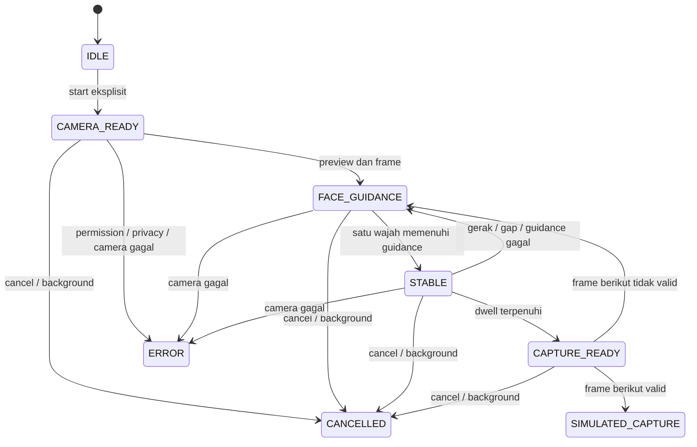

# FL-CAM01 — KYC Camera Proof Closure & Integration Readiness

Tanggal pengujian: 25 Oktober 2026. Mode: **ISOLATED PROTOTYPE VALIDATION**.

**Keputusan: GO untuk kelayakan preview/guidance portrait dan simulasi terisolasi; NO-GO untuk integrasi kamera ke aplikasi utama dan capture wajah manusia.** APK release R2 berjalan tanpa Metro pada TECNO LJ7. Jalur pemilihan frame/encoding JPEG dan jaminan tanpa gambar plaintext persisten belum dibuktikan. Tidak ada approval integrasi yang diberikan oleh hasil ini.

Ini bukan Enrollment E2E PASS, Biometric Security PASS, Liveness/PAD PASS, atau Recognition Accuracy PASS. Tidak menggunakan wajah mahasiswa/manusia, tidak membuat template, API enrollment, atau payload backend.

> Lanjutan: [FL-CAM02 — laporan A–M](FL_CAM02_TECHNICAL_PROOF.md) membuktikan terminal live dan same-frame JPEG R2, memperbaiki overflow numerik crop, serta mencatat storage/lifecycle/telemetry aktual. Gate keseluruhan PARTIAL; capture manusia/integrasi production tetap NO-GO. CAM01 di bawah dipertahankan sebagai catatan historis.

## A. Git baseline dan batas perubahan

- Branch awal: `feat/fl-otp01-email-auth`.
- HEAD: `87bac5e96602e9ff5568069d1c6b1bd1d96913b7`.
- Baseline: 26 tracked unstaged, 23 untracked, 0 staged. Perubahan CORE01/CORE02, R5, ENR00/ENR00R yang sudah ada bukan hasil CAM01 dan dipertahankan.
- Dibaca: README, PROJECT_STATE, PRD, DECISIONS, ARCHITECTURE, SECURITY_PRIVACY, laporan [FL-CAM00](FL_CAM00_TECHNICAL_PROOF.md), serta source prototype/dependensi terkait.
- Source hanya pada `research/fl-cam00-proof/`; dokumentasi pada laporan ini dan PROJECT_STATE. Tidak mengubah `apps/mobile`, OTP/session, role, backend, database, keputusan P01–P12, ESP-CAM, video atau backup. Tidak commit/push/merge PR #19.
- **Penyimpangan preservasi artefak:** `npx expo prebuild --platform android --no-install` ternyata mengeluarkan pesan `Clearing android` dan meregenerasi direktori native. APK debug x86_64 lama dalam `android/app/build/outputs/apk/debug/` hilang. Ini sudah diungkapkan saat terjadi; tidak diklaim dipulihkan. Salinan root `cam00-arm64-debug.apk` tetap utuh. Prebuild tidak diulang; perubahan berikutnya disinkronkan ke plugin dan generated source secara terbatas.

## B. Source prototype yang berubah

Semua path berikut relatif terhadap `research/fl-cam00-proof/`:

| Berkas | Perubahan |
|---|---|
| `App.tsx` | Start kamera eksplisit, transform native, overlay ellipse, reducer guidance, generation guard, cancel/background, diagnostik numerik lokal, synthetic event fixture terlabel, metadata sandbox |
| `guidanceModel.ts` | Validasi satu wajah/pose/ellipse, dwell berbasis frame dan waktu, reset dropout/movement/layout, state machine tanpa photo capture |
| `guidanceModel.test.mjs` | 16 pengujian perilaku geometry, ambang, transisi, stale callback, dan fail-closed |
| `app.json` | Nama CAM01, portrait, package prototype tetap terisolasi, backup off, permission terbatas |
| `plugins/withCam01Privacy.js` | Konfigurasi Android reproducible: secure window/recents, portrait, release permission policy, Gradle release nondebuggable, keep rules ML Kit |
| `plugins/android/Cam01PrivacyModule.kt` | Bridge proteksi layar dan inventaris metadata sandbox; tidak mengembalikan isi file/piksel |
| `plugins/android/Cam01PrivacyPackage.kt` | Registrasi bridge native |
| `fixture-viewer.html`, `serve-fixture.mjs` | Viewer mannequin lokal dengan 0/1/2 wajah, ukuran/pergeseran dan marker asimetris; server hanya `127.0.0.1:8769` |
| `audit-apk.mjs` | Audit package, manifest, permission, bundle JS, ABI dan alignment APK/ELF release |

Generated project `android/` mengikuti plugin: MainActivity/MainApplication, bridge Kotlin, manifest, resource backup, build/release dan ProGuard. Tidak ada patch source `node_modules` yang dibutuhkan. Versi dependency proyek tidak dinaikkan.

## C. Native compatibility

- Expo terpasang 58.0.19; React 19.3.0; React Native 0.88.0; VisionCamera 5.2.3; face-detector 2.1.0; Nitro Modules 0.37.1; Nitro Image 0.15.2.
- Bundled ML Kit dipakai untuk deteksi, bukan model recognition. Source paket native diperiksa terhadap arsip registry; perbaikan transform/fix-prefab terkait sudah berada di versi upstream yang terpasang.
- Toolchain build: JDK 17.0.20.1, Gradle 9.4.1, AGP 9.2.1, Kotlin 2.2.10, CMake 3.31.6, NDK 27.1.12297006; compile SDK 37, target SDK 36, min SDK 24.
- Perangkat fisik: TECNO LJ7, Android 16/API 36, ARM64. Bukti runtime hanya untuk perangkat ini.
- APK: 23 native library ARM64, 69 ELF LOAD segments, alignment statis minimal 16 KB dan offset congruence lulus; `zipalign -c -P 16 4` lulus. HP memakai page size 4096: **runtime 16 KB belum diuji**. CAM01 tidak membuat release x86_64.
- Factory output dimemoisasi per generation. Ini menghindari churn output dari hook detector yang membentuk object options baru; tidak membuat detector baru per frame.

## D. Preview, mirror, orientation, crop dan oval

- Front camera, `mirrorMode: on`, detector `autoMode: true`, `orientationSource: interface`, preview `cover`, implementation `compatible`.
- Bounding box tidak diproyeksikan memakai rasio ukuran frame mentah. Keempat sudut dipetakan melalui `CameraRef.convertCameraPointToViewPoint()`, kemudian dibentuk kembali menjadi extent view-space positif. Transform native memiliki informasi sensor rotation, front mirror dan crop/scaling preview.
- Overlay dan ellipse memakai container `onLayout` yang sama dalam dp; ellipse digambar sebagai lingkaran berskala, bukan rounded rectangle/capsule.
- Layout fisik terukur: view 371.9 × 473.7 dp, density 2.70 px/dp; oval x=34.3, y=33.2, w=303.2, h=407.4 dp. Ini diagnostik mannequin, bukan kalibrasi akurasi identitas.
- Pengguna mengonfirmasi box mengikuti mannequin, masuk oval, pergeseran lateral mengikuti target dan marker L/R terpantul sesuai preview depan. Bukti visual ini adalah observasi pengguna; screenshot kamera tidak dibuka untuk audit karena `FLAG_SECURE`.
- Unit test memeriksa mirror, cover crop, rotasi 90/180/270°, axis reversal, corner extent dan containment ellipse. Ini bukan pengganti kalibrasi pixel-level native pada semua perangkat.
- **PORTRAIT-ONLY:** manifest portrait/nonresizeable dan orientation aplikasi lokal, bukan pengubahan global. Pengguna mengonfirmasi rotasi fisik 90° lalu kembali tidak merusak portrait atau menumpuk UI. Baseline OS sudah memiliki rotation lock, sehingga pengujian ini tidak membuktikan perilaku pada OS dengan auto-rotate terbuka. Landscape tetap unsupported; tidak ada redesign aplikasi utama.

## E. Live mannequin detection

Media berasal dari mannequin nonmanusia `CosSchlHead2on112010`, CAMiller62, CC BY-SA 3.0, [Wikimedia Commons](https://commons.wikimedia.org/wiki/File:CosSchlHead2on112010.jpg). SHA-256 aset awal: `3d3d2f4978058389b8b8197b938dac67d476ae7d3af1aaaa233584a209e9ec089`. Viewer juga membuat turunan mannequin frontal simetris dan dua mannequin di canvas; tidak menyimpan foto baru. Pengguna secara eksplisit menyediakan HP dan mengarahkan front camera ke fixture laptop.

Trace `CAM01_EVENT` berikut berasal dari **input kamera live**, bukan file detector. Waktu adalah timestamp log perangkat:

| Waktu | State/reason | Jumlah wajah |
|---|---|---:|
| 11:50:25.835 | CAMERA_READY / NO_FACE | 0 |
| 11:50:27.030 | FACE_GUIDANCE / NO_FACE | 0 |
| 11:51:49.117 | FACE_GUIDANCE / OUTSIDE_OVAL | 1 |
| 11:51:50.630 | STABLE / HOLD_STILL | 1 |
| 11:51:51.710 | FACE_GUIDANCE / OUTSIDE_OVAL — dwell reset | 1 |
| 11:51:53.654 | FACE_GUIDANCE / MOVEMENT | 1 |
| 11:54:54.250 | FACE_GUIDANCE / MULTIPLE_FACES | 2 |

Diagnostik sebelum stop menunjukkan 11.380 callback diterima dan 19 callback/detik pada sampel tampilan tersebut; bukan benchmark kontinu. Nol wajah, satu wajah, lebih dari satu, target terlalu jauh, keluar oval dan gerakan menghasilkan guidance/rejection yang berbeda. Tidak ada klaim recognition atau PAD dari mannequin.

## F. Simulated auto-capture



- Dwell minimal 1500 ms, minimal 6 sampel, gap maksimal 400 ms. Waktu tanpa frame valid tidak dapat memicu capture.
- Wajib tepat satu wajah, seluruh box masuk ellipse, ukuran minimum terpenuhi, yaw/pitch maksimal 12°, roll maksimal 10°. Stabilitas dibandingkan anchor: center 2,5% view, ukuran 6%, pose 3°. Movement, 0/2 wajah, perubahan layout, dropout/clock rollback membatalkan akumulasi.
- `CAPTURE_READY` bukan capture langsung: dibutuhkan frame valid berikutnya. Late callback dari generation sebelumnya diabaikan setelah cancel/restart.
- Uji on-device melalui tombol **Uji event sintetis (bukan live)** menghasilkan `SIMULATED_CAPTURE / SIMULATED_ONLY`, source `SYNTHETIC_FIXTURE_VIRTUAL_TIME`, stableMs=1800, samples=10. Ini **waktu virtual fixture**, bukan latency kamera/encoding. Kamera berhenti dan tidak ada foto dibuat.
- 16 unit test lulus, termasuk live-source events pada reducer, batas dwell, invalidasi readiness, background/cancel, error dan restart. Nama source `live` dalam unit test bukan bukti hardware.
- **Batas bukti live:** pengguna melaporkan melihat SIMULATED_CAPTURE/kamera berhenti saat percobaan live. Namun trace yang tertangkap hanya membuktikan STABLE lalu reset; tidak ada event live SIMULATED_CAPTURE dalam trace. Tidak dinyatakan sebagai live auto-capture PASS yang dapat direproduksi. Rekaman state live terukur sampai terminal state masih dibutuhkan sebelum gate itu ditutup.
- Tidak ada shutter manual, pemilihan frame, encoder JPEG, penyimpanan foto atau upload. Tidak ada klaim liveness/PAD.

## G. Frame, buffer, encoding dan storage

### Pemeriksaan source

- Native ImageAnalysis memakai `KEEP_ONLY_LATEST` dan guard single-flight. Input ML Kit dibentuk dari media image; `ImageProxy` ditutup pada success/error/drop. Dispose menunggu pekerjaan aktif tanpa timeout eksplisit: soak/stall cleanup belum dibuktikan.
- JS menerima metadata deteksi untuk guidance, bukan buffer JPEG. Log state tidak membawa piksel, pose, bounding box, token atau embedding. Diagnostik bounds/pose hanya di UI lokal fixture.
- Jalur static file detector lama tetap terpisah dan tidak memberi makan state machine live. Nitro Image/image loader berada dalam dependency graph; keberadaannya tidak membuktikan semua cache dinonaktifkan.
- Tidak menjalankan encoding JPEG dummy karena encoder bukan implementasi CAM01. **Alokasi/latency/storage encoder: NOT_RUN**, bukan nol. Tidak ada payload backend.

### Snapshot metadata sandbox sebelum/sesudah live

Bridge native membaca hanya path relatif, ukuran, mtime dan signature 12 byte awal PNG/JPEG/WebP di `files`, `cache`, `codeCache`, `noBackup`, `databases`, `sharedPrefs`. Tidak membaca/menampilkan isi database/preference, piksel, atau external storage. Root yang tidak ada dilewati hanya untuk ENOENT; error audit lain menolak audit, bukan dianggap sandbox kosong. Tidak menghapus file.

Kedua snapshot: **11 file, 4.871.132 byte**. Tidak ada path baru atau perubahan ukuran. Satu perbedaan mtime: `sharedPrefs/visioncamera.permissions.xml` (224 byte), dari 1792886803000 menjadi 1792903766000 setelah siklus permission.

Temuan penting yang sudah ada sebelum scan CAM01 dan tetap sama sesudahnya:

| Path sandbox | Ukuran | mtime | Keterangan |
|---|---:|---:|---|
| `cache/image_cache/v2.ols100.1/8.0/vmYuN2Tf2zQJBNPh_9xpXzOkGlo.cnt` | 187 B | 1792886949000 | Signature PNG, cache kecil historis CAM00; tidak dihapus |
| `databases/com.google.android.datatransport.events` | 65.536 B | 1792887045000 | Metadata database SDK; isi tidak diekstrak |
| `databases/com.google.android.datatransport.events-journal` | 0 B | 1792886524000 | Journal SDK |
| `files/BridgelessReactNativeDevBundle.js` | 4.116.651 B | 1792886948000 | Sisa instalasi debug lama; bukan bundle yang dibutuhkan release |
| `cache/http-cache/journal` | 36 B | 1792886525000 | Metadata cache lama |

Snapshot tidak membuktikan tidak ada temporary write-and-delete di antara snapshot, isi tidak berubah, native buffer terhapus secara kriptografis, atau tidak ada penyimpanan lewat sistem/IPC. Sandbox tidak dibersihkan karena harus mempertahankan artefak sebelumnya. Keberadaan file dev lama dalam app data tidak berarti APK release membawa dev bundle tersebut.

**Kesimpulan:** tidak terlihat gambar baru/persistensi foto pada jalur scan yang diuji. **Memory-only end-to-end, termasuk encoding, belum terbukti; capture wajah nyata NO-GO.** Mitigasi sebelum tugas capture: pilih API frame/encoder dengan ownership/release jelas, ukur RAM/allocation/latency memakai dummy, audit write/cache selama operasi dan crash/force-stop, inventaris dependensi image loader, cegah cache plaintext tanpa menghapus bukti historis tanpa izin. Ini rekomendasi, belum implementasi.

## H. Telemetry dan dependency disclosure

- ML Kit dan Google DataTransport ada dalam dependency graph; database lokal DataTransport/ML Kit preference ditemukan. Tidak mengklaim zero-telemetry.
- [ML Kit terms](https://developers.google.com/ml-kit/terms) dan [Android data disclosure](https://developers.google.com/ml-kit/android-data-disclosure) menyatakan image/video input dan hasil diproses on-device dan tidak dikirim ke Google oleh ML Kit; SDK dapat mengumpulkan metadata seperti metrik penggunaan/performa dan identifier instalasi. Ini pernyataan vendor, bukan packet capture independen sesi ini.
- APK release aktual tidak memiliki `INTERNET`, `ACCESS_NETWORK_STATE`, atau `ACCESS_LOCAL_NETWORK`. Ini membatasi koneksi socket biasa UID aplikasi dan membuktikan tidak perlu jaringan untuk smoke tersebut; **bukan** bukti tidak ada local telemetry queue atau semua jalur system-service/IPC.
- Keberadaan database SDK bukan bukti pengiriman gambar biometrik. Tidak ditemukan bukti upload gambar pada jalur ini, tetapi tidak dilakukan packet capture, inspeksi isi database, atau audit SDK binary menyeluruh.
- Dependencies yang perlu disclosure sebelum produk: Expo/RN, VisionCamera/Nitro, face-detector, ML Kit/Google Play Services terkait, DataTransport dan image loader. Release proof tanpa network permission bukan keputusan otomatis untuk aplikasi utama yang memerlukan jaringan.

## I. Android lifecycle, screenshot dan permission

- `FLAG_SECURE` diterapkan sebelum React dibuat dan dipertahankan pada semua layar, termasuk setelah stop. API 33+ menonaktifkan recent-app snapshot. Bridge tidak dapat membuka proteksi saat scanning=false; gagal bridge membuat start fail-closed.
- Screenshot ADB saat scan hanya diproses dalam RAM host, tidak disimpan. Resolusi 1080×2460; area tengah 20–80% lebar, 20–70% tinggi memiliki maksimum RGB=0. Proteksi screenshot teramati; bukan pengujian semua OEM/metode screen recording. Pengguna juga mengonfirmasi recent card terlindung. Acuan: [Android secure activities](https://developer.android.com/security/fraud-prevention/activities).
- `KEYCODE_HOME` saat live menghasilkan `CANCELLED / BACKGROUND` pukul 12:00:03.777. Camera service menunjukkan device 0 dan 1 closed/no client. Resume HOT (91 ms total, 97 ms wait) tetap kamera OFF; UI fresh menunjukkan CANCELLED/BACKGROUND, faces=0, stableMs=0, samples=0, box=none. Tidak mengaktifkan kamera diam-diam saat resume.
- Force-stop lalu cold-start berikutnya menghasilkan IDLE/OFF dan tidak membuka kamera. Uji tambahan start eksplisit lalu force-stop juga menutup kedua camera device/no client. Prototype ditinggalkan **force-stopped**, bukan scanning.
- Permission dialog sistem sempat membackground-kan aplikasi; state dibatalkan, start berikutnya eksplisit. Status OS yang benar-benar dibaca kemudian CAMERA granted=true. Percobaan memilih deny tidak menghasilkan bukti OS denied, sehingga **denied/revoked/one-time permission lifecycle belum dinyatakan PASS**. Tidak memakai `pm grant/revoke` atau mengubah permission global.
- Error/cancel/generation reset dibuktikan unit test dan code path fail-closed. Native error/permission-revocation saat frame sedang diproses, process-death di tengah encoding, serta soak/leak belum diuji. Tidak ada encoder/image capture yang dapat diklaim telah dibersihkan.
- Keterbatasan alat: `uiautomator dump` kadang gagal idle saat callback aktif dan meninggalkan XML lama meskipun exit code 0. XML stale tidak dipakai sebagai bukti live; lifecycle dan fixture dibaca ulang ketika kamera berhenti dan UI stabil. XML sementara audit milik CAM01 di `/sdcard/cam01-window.xml` dibersihkan.

## J. Release standalone

Perintah yang dijalankan dari direktori prototype:

```text
node --experimental-strip-types --test guidanceModel.test.mjs
npm run typecheck
cd android
gradlew.bat assembleRelease -PreactNativeArchitectures=arm64-v8a --console=plain
cd ..
node audit-apk.mjs cam01-arm64-release-r2.apk
```

- Guidance final: **16/16 PASS**, fail=0; TypeScript exit 0. Warning Node `MODULE_TYPELESS_PACKAGE_JSON` nonfatal tetap ada; tidak mengubah seluruh package menjadi ESM karena plugin Expo CommonJS.
- Build release R2: **BUILD SUCCESSFUL, 4m14s**, lint dan R8 tetap aktif. Audit APK R2 PASS, embedded JS bundle 1.369.132 byte.
- Package `ai.facelink.cam00proof`, bukan package aplikasi utama. Manifest actual hanya memiliki `CAMERA` dan permission internal `ai.facelink.cam00proof.DYNAMIC_RECEIVER_NOT_EXPORTED_PERMISSION`; tanpa internet/storage/media/overlay. Nondebuggable, jniDebuggable false, cleartext dan backup false. Native ABI hanya arm64-v8a.
- Tidak menemukan file `.env` project-local prototype; source proof tidak mengimpor konfigurasi auth/backend produksi. Ini audit terbatas, bukan pembuktian matematis tidak ada secret dalam seluruh dependency binary.
- APK memakai Android debug certificate lokal yang sama dengan CAM00 agar update in-place tidak menghapus data. Certificate SHA-256 `fac61745dc0903786fb9ede62a962b399f7348f0bb6f899b8332667591033b9c`. **Build variant release bukan signing produksi/distribusi.** Tidak ada production signing secret.
- APK R2 terpasang memiliki SHA-256 sama dengan artefak root. Cold launch R2 pertama: status ok, TotalTime 300 ms, WaitTime 314 ms, UI IDLE tampil. Cold restart kemudian: 690/714 ms. Tidak ada Metro, ADB reverse kosong, dan no-INTERNET release berfungsi.
- Setelah perbaikan R2 tidak ada crash native baru yang teramati selama cold-start/scan/background/force-stop yang diuji. Crash buffer masih memuat kegagalan R1; tidak dihapus untuk membuat hasil tampak bersih.

### Kegagalan sebelum hasil final

1. Build awal gagal `lintVitalRelease / HardcodedDebugMode` karena atribut `android:debuggable=false` eksplisit. Atribut manifest dihapus; Gradle release tetap debuggable=false. Lint tidak disuppress.
2. Parser audit awal tidak mengenali format AAPT2 v37 untuk enum/boolean. Parser diperbaiki dan audit dijalankan kembali terhadap APK aktual.
3. APK `cam01-arm64-release.apk` lulus audit statis tetapi **crash cold-start**: `FaceDetection.getClient` melalui eager `ImageFaceDetectorFactory`, NPE, PID 30592 pukul 11:30:57.662. R8 usage menunjukkan constructor registrar yang dipanggil via nama manifest terhapus. Ditambahkan keep rules terbatas untuk constructor publik `CommonComponentRegistrar`, `VisionCommonRegistrar`, `FaceRegistrar`; bukan mematikan minification atau menyembunyikan exception. R2 kemudian benar-benar menampilkan UI dan menjalankan live detector.
4. Install R2 timeout saat installer HP menunggu pengguna. Tidak reboot/mengubah USB/developer settings. Pengguna membuka/menyetujui installer; installed hash kemudian cocok dengan R2.

Artefak root dipertahankan; **pilih R2, bukan R1**, untuk mengulang smoke:

| Artefak | SHA-256 | Status |
|---|---|---|
| `cam00-arm64-debug.apk` | `5fcecf9af04945769217f31019c4affe8eaf1251bb451b295f92c0c3c3dadf35` | Salinan CAM00 awal dipertahankan |
| `cam01-arm64-release.apk` | `221b5a5ea4d0ef08b9f7af82344547d694890855926e046d7d56ae2394518d59` | R1, runtime FAIL; dipertahankan sebagai bukti |
| `cam01-arm64-release-r2.apk` | `d29092015bd779962b68b103bb370d726e721866fadd6d9375b002387349a955` | R2, static audit dan physical smoke PASS terbatas |

## K. Device settings reconciliation

Nilai sebelum dan sesudah CAM01 dibaca tanpa perubahan:

| Pengaturan | Awal CAM01 | Akhir CAM01 | Nilai sebelum CAM00 |
|---|---:|---:|---|
| `screen_brightness` | 4 | 4 | Tidak diketahui |
| `screen_brightness_mode` | 0 | 0 | Tidak diketahui |
| `screen_off_timeout` | 1800000 | 1800000 | Tidak diketahui |
| `stay_on_while_plugged_in` | 15 | 15 | Tidak diketahui |
| `accelerometer_rotation` | 0 | 0 | Tidak diketahui |
| `user_rotation` | 0 | 0 | Tidak diketahui |
| `locksettings get-disabled` | false | false | Tidak dipastikan |

CAM00 pernah mengubah brightness/mode/timeout/stay-awake, menguji global rotation, mencoba lock setting dan reboot; nilai awal tidak direkam lengkap. CAM01 **tidak menebak atau memulihkannya**. Tidak menulis setting global/developer/USB/permission, tidak reboot/reset, tidak uninstall aplikasi apa pun. Instalasi hanya update prototype yang disetujui dan interaksi scan eksplisit dengan pengguna. Pemulihan ke preferensi pemilik memerlukan nilai tujuan dan izin terpisah.

## L. Remaining security blockers

1. **Real-face capture NO-GO:** encoder/frame ownership/temp cache, alokasi/latency dan memory-only end-to-end belum dibuktikan. Snapshot stabil bukan forensic proof.
2. **Live terminal capture trace belum tertutup:** user-observed simulated capture tidak didukung trace live yang dapat diulang; synthetic fixture hanya membuktikan reducer dengan virtual time.
3. **Telemetry belum tertutup:** metadata SDK/local queue ada; tidak ada packet capture atau audit semua IPC. Tidak boleh mengubah hasil menjadi klaim zero-telemetry ketika main app memerlukan INTERNET.
4. **Lifecycle coverage parsial:** denied/revoked/one-time permission, native error di tengah frame, encoder process-death, long soak/dispose stall dan runtime 16 KB belum diuji.
5. **Integrasi produk belum disetujui:** P01–P12, consent/retensi/KeyProvider dan kontrak enrollment tidak berubah. Hasil prototype bukan izin menangkap wajah manusia.
6. **Distribusi:** key lokal debug bukan signing produksi; perlu proses signing tersendiri bila distribusi kelak disetujui. Tidak ada implementasi distribusi dalam tugas ini.
7. **Kepatuhan artefak:** generated x86_64 debug APK lama hilang saat prebuild; tidak menyatakan seluruh artefak awal dipertahankan.

## M. GO / NO-GO dan penghentian

| Gate | Keputusan | Dasar |
|---|---|---|
| Kandidat native/front preview portrait pada TECNO LJ7 | GO terbatas | Release R2 dan live 0/1/2 wajah berjalan; visual alignment dikonfirmasi pengguna |
| Guidance dan simulated capture tanpa foto | GO terisolasi | 16 tes, live STABLE/rejection, on-device synthetic terminal state terlabel |
| Live auto-capture terminal state dapat direproduksi | BELUM TERVERIFIKASI | Trace belum memuat event live terminal; tidak menyamakan virtual fixture dengan live |
| Capture wajah manusia / encoding / penyimpanan | NO-GO | Memory-only end-to-end belum terbukti |
| Integrasi kamera ke aplikasi FaceLink utama | NO-GO | Blocker privasi/coverage dan approval integrasi belum tertutup |
| Enrollment produksi / recognition / liveness | TIDAK DIUJI / DI LUAR SCOPE | Tidak diimplementasikan dan tidak dinyatakan lulus |

Laporan menutup pekerjaan validasi dengan hasil aktual dan gap eksplisit, **bukan menutup seluruh blocker menjadi PASS**. Langkah yang direkomendasikan hanya review Product Owner atas bukti/blocker dan persetujuan tugas validasi lanjutan yang terukur bila diinginkan. Tidak otomatis memulai FL-ENR01 atau ESP-CAM.

Pada akhir pengujian kamera prototype force-stopped, semua camera client tertutup, log reader dan viewer proof dihentikan, tidak ada Metro/reverse proof. APK, source fixture dan bukti historis dipertahankan. Tidak menghapus cache/data aplikasi lama atau mengklaim pemulihan setting sebelum CAM00.
